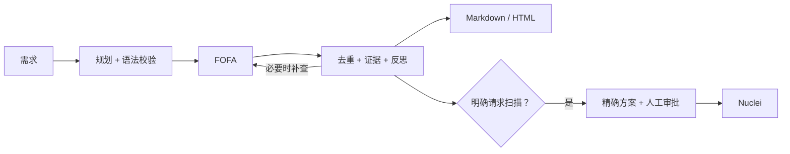

# 🗺️ FofaMap 2.0.2 · 从资产发现到证据报告

**中文** · [English](README_EN.md)


<p align="center">
  
  
  
  
</p>

**找资产、理证据、出报告，需要扫描时由你确认。**

FofaMap 是 **Hx0 工作室**开发的 FOFA 资产测绘工具。新手用方向键向导，熟悉 FOFA 的用户直接写查询；需要自动分析时，可以用自然语言描述任务，也可以把工具接入自己常用的 AI 助手。**普通查询只需 FOFA API Key，无需配置模型。**

<a id="whats-new"></a>

## FofaMap 能为你做什么？

| 你的任务 | FofaMap 的做法 | 你得到什么 |
|---|---|---|
| 不熟悉 FOFA，也想开始测绘 | 账号配置引导、方向键菜单、智能字段选择 | 从填 Key 到第一次查询的清晰路径 |
| 一句话完成资产调查 | Agent 规划查询、根据实际命中反思，区分已观察资产、交叉印证与待复核候选 | 能回看查询过程和证据的资产简报 |
| 把结果交给同事继续分析 | Markdown / HTML 报告，表格搜索、排序、选列，导出可见行 CSV / 去重 TXT | 可直接打开、筛选和交付的报告 |
| 希望 AI 助手直接调用工具 | 31 个 MCP 工具 + 配套 Skill，支持多种宿主 | 继续使用宿主模型，通常无需再配置一套模型 Key |
| 从测绘继续做授权扫描 | 用户的扫描意图优先；先展示目标、模板和级别，确认方案后执行 | 查询、审批、Nuclei 结果与报告串在同一任务中 |
| 周期盘点资产变化 | 定时任务、独立 worker、快照对比 | 能追踪新增和消失资产的重复测绘流程 |

**第一次使用，按下面的 1 → 2 → 3 完成即可。** 参数、模型、自动化和服务部署都可以之后再看。

| 第一次使用 | 日常查询 | 进阶能力 | 维护与参考 |
|---|---|---|---|
| [1. 安装](#install) | [语法入门](#query-language) | [AI 调查与报告](#agent) | [更新 / 修复 / 卸载](#upgrade) |
| [2. 配置 FOFA Key](#configure) | [常用命令](#recipes) | [MCP / Skill](#mcp) | [常见问题](#troubleshooting) |
| [3. 第一次查询](#first-query) | [智能字段在哪开](#smart-fields) | [定时测绘](#schedule) | [完整参数](#cli-reference) |
| [选择使用方式](#choose) | [导出与分页](#exports) | [授权扫描](#scan) | [配置 / REST](#configuration) |

<a id="install"></a>

## 1. 安装：选你的系统，一键完成

下载 [FofaMap 2.0.2 用户源码包](https://github.com/asaotomo/FofaMap/releases/download/v2.0.2/FofaMap-2.0.2-source.zip)，**完整解压**，打开能看到 `install.bat`、`install.command`、`install.sh` 的文件夹。更多下载选项见 [2.0.2 发行页面](https://github.com/asaotomo/FofaMap/releases/tag/v2.0.2)。

| 系统 | 你需要做什么 | 下次怎么打开 |
|---|---|---|
| **Windows 10/11 x64、Windows 11 ARM** | 双击 **`install.bat`**，首次选择安装 | 新开终端输入 `fofamap`，或双击 `start.bat` |
| **macOS Intel / Apple 芯片** | 双击 **`install.command`**，首次选择安装 | 输入 `fofamap`，或双击 `start.command` |
| **Linux x86_64 / ARM64** | 在项目目录运行 **`bash install.sh`** | 输入 `fofamap`，或运行 `bash start.sh` |

**先选安装语言。** 安装器首先显示 **简体中文 / English**，选定后，安装提示、账号配置和后续界面沿用这个选择，无需编辑配置文件。直接回车沿用上次安装语言或系统语言默认值。


首次需要联网。安装器会准备独立 Python 和依赖、检查安装，并配置 `fofamap` 命令。**不需要手动激活环境，也不需要管理员权限。安装结束后会进入账号配置，接着做第 2 步。** 如果找不到命令，先关闭旧终端并新开一个。

<details>
<summary>查看首次安装菜单</summary>


</details>

<details>
<summary>macOS / Linux：在终端安装，或解决双击脚本无权限</summary>

### macOS / Linux：一条安装命令

也可在终端进入解压后的项目文件夹，执行下面的安装和版本检查。macOS 双击脚本没有执行权限时，也使用这个入口。

```bash
bash install.sh
bash start.sh --version
```

<details>
<summary>查看实操结果：一键安装与自检</summary>


</details>

手动方式见 [macOS / Linux 安装](docs/INSTALL_MANUAL.md)。

</details>

<a id="windows-install"></a>

Windows 遇到问题，按 [Windows 详细步骤与排错](docs/INSTALL_WINDOWS.md)操作；macOS/Linux 可看 [手动安装说明](docs/INSTALL_MANUAL.md)。再次运行安装器会提供修复和卸载，详见 [维护说明](#upgrade)。

<a id="configure"></a>

## 2. 填入 FOFA Key，先完成普通查询配置

1. 登录 [FOFA](https://fofa.info/)，在个人中心找到并复制你的 **API Key**；没有账号先注册。
2. 在自动打开的账号配置页粘贴 Key，邮箱可选，按提示保存并验证。
3. 询问是否配置 AI 时，第一次只做普通查询可以选 **暂不配置 / N**。之后需要 Agent 再添加模型。

没看到表单，或想修改 Key？在终端执行：

```bash
fofamap --setup
```


**FOFA Key 用来查询资产，模型 Key 用来调用 AI，两者不同。** 不要把真实 Key 发到聊天、Issue 或截图中。后续打开时，如果必要配置缺失、损坏或凭据失效，程序会引导修复。

<a id="first-query"></a>

## 3. 完成第一次查询

### 推荐：打开向导，不用先记参数

```bash
fofamap
```


1. 用方向键选择 **资产搜索**，回车确认。
2. 粘贴 `domain="baidu.com"`，查询百度公开网站；这是输入到程序里的 FOFA 语法，不需要再加外层引号。
3. **最大查询页数填 `1`**，返回字段选 **使用默认固定字段**（也可选智能选择）。历史数据和导出高级选项先选 N，询问 Nuclei 扫描时选 **N**。
4. 等待结果表。页数控制取几页，每页条数跟随当前配置；想把第一次请求明确限制为最多 3 条，用下面的命令。

方向键选择，回车确认；Esc / Ctrl+C 返回上一级。上图展示当前输入界面，下图展示一次已完成的真实查询结果。

### 也可以复制命令：只取 3 条，不扫描

无需模型。使用一个明确域名，限制 1 页、每页 3 条、最多 3 条，关闭存活检测和自动保存。

```bash
fofamap -q 'domain="baidu.com"' -f host,ip,port,protocol,title \
  --size 3 --pages 1 --max-records 3 \
  --no-check-alive --no-full --no-save
```


看到主机、IP、端口、协议和标题表，表示真实查询已成功。截图展示 FOFA 匹配总量与本次实际取回的最多 3 条记录；**总量不等于已收集数量**。HTTP 和 HTTPS、主域名和 www 可能是不同端点，不应只因同 IP 就合并。

逐项读懂命令：`-q` 后是“找什么”；`-f` 后是“返回哪些字段”；`--size 3` 是每页条数；`--pages 1` 是本次页数上限；`--max-records 3` 是本次总上限；`--no-save` 仅不落盘，不代表不消耗 FOFA 额度。

Windows 新手优先使用上面的向导，避免 CMD / PowerShell 对引号的不同处理。以上命令的引号写法适用于 macOS/Linux；Windows 引号排错见 [安装指南](docs/INSTALL_WINDOWS.md)。

**到这里已经能开始使用了。** 下一步：需要文件就看[导出](#exports)，需要一句话调查就看[AI 助手](#agent)，想在现有 AI 工具里用就看[MCP / Skill](#mcp)。

<a id="choose"></a>

## 4. 接下来，选择适合你的使用方式

| 你想做什么                            | 用哪个入口                  |    FOFA Key   |           额外模型           |
| -------------------------------- | ---------------------- | :-----------: | :----------------------: |
| 已知语法，找资产、看画像、统计、导出               | CLI / 交互向导             |       需要      |            不需要           |
| 一句话描述，让工具规划和写总结                  | 本地 `-ai` Agent         |       需要      |          需要配置模型          |
| 在 Codex / Cursor / Claude 等对话里使用 | MCP + Skill            |       需要      |          通常用宿主模型         |
| 定时重复测绘、比较快照                      | schedule + 独立 worker   |       需要      | 固定查询且 analyze=false 时不需要 |
| 供其他程序调用                          | REST API               |       需要      |      只有 Agent 接口才需要      |
| 主动扫描                             | 上述入口 + Nuclei + 精确方案审批 | 从 FOFA 取目标时需要 |        本地确定性扫描不需要        |

**三个容易混淆的概念：** FOFA 是被动索引查询；`--check-alive` 会主动连接目标做 HTTP 存活检测；`-n` 会进入 Nuclei 扫描审批。它们不是同一件事。本文入门查询明确使用 `--no-check-alive`，不加 `-n`。

### 首页与设置菜单

首页按使用频率保留 AI 任务助手、资产搜索、主机详情、分布统计；批量查询与图标反查放在「更多查询方式」，规则和字段放在「查询参考」。账号、模型、界面语言、默认返回字段、偏好和更新统一放在「设置与维护」。进入子菜单按 Esc 返回，不会退出程序。


### 随时切换界面语言

打开 **设置与维护 → 界面语言 / Language**，选择中文或 English，保存后立即生效并沿用到下次启动，无需重填账号或模型。

```bash
fofamap
```


<a id="query-language"></a>

## 5. 逐步学会 FOFA 查询

**查询字段与返回字段不是同一份目录。** `domain="baidu.com"` 是条件；`-f host,ip,port` 是结果列。`product.version` 可以是查询条件，但不是 Stats 维度；`sdk_hash` 等语法字段也不一定能作为返回列。

| 写法 | 含义 | 示例 |
|---|---|---|
| `=` / `==` / `!=` | 匹配 / 完全匹配 / 排除 | `domain=="baidu.com"` |
| `&&` / `\|\|` / `()` | 与 / 或 / 分组 | `(port=80 \|\| port=443) && country="CN"` |
| `domain` / `host` / `ip` | 域名 / 主机 / IP 或网段 | `ip="192.0.2.0/24"`（仅语法示意） |
| `title` / `header` / `body` | 页面线索 | `title="Bing"` |
| `app` / `product` | 官方指纹 / 产品标签 | 先查 rules，不猜 app 名 |
| `country` / `region` / `city` | 国家 / 省区 / 城市 | `country="CN" && city="Shanghai"` |
| `status_code` | 索引中的 HTTP 状态 | `status_code=200` 或 `status_code="200"` |
| `after` / `before` | FOFA 更新时间 | `after="2026-11-01"`，不是首次发现 |
| `is_cloud` / `cert.is_valid` | 布尔字段 | `is_cloud=true` |

字符串用英文双引号。macOS/Linux 外层单引号可保护内部双引号；PowerShell 也建议外层单引号，并确认原生程序参数保留内部引号；不同 PowerShell 版本存在参数转义差异，遇到问题直接在交互向导中粘贴 FOFA 语句。不要把中文弯引号当双引号。`city` 使用英文名；`region` 在中国可用中文；`country` 可用国家代码。

### 查本地语法目录

不发 FOFA 请求。结构校验不能保证会员权限、app 名存在或服务器语义一定接受。

```bash
fofamap syntax
```

<details>

<summary>查看实操结果：查本地语法目录</summary>


</details>

### 查返回字段和会员能力

不消耗 FOFA 额度；截图为实际目录的末屏。需要完整机器可读目录可使用对应 MCP 工具 `fofa_fields(section="all")`。

```bash
fofamap fields
```

<details>

<summary>查看实操结果：查返回字段和会员能力</summary>


</details>

<a id="smart-fields"></a>

### 智能字段在哪里设置？

**填完页数就能选，不再藏在高级选项里。** 路径：**资产搜索 → 输入查询 → 最大查询页数 → 本次返回字段 → 智能选择**。想记住默认值：**设置与维护 → 返回字段 → 智能选择**。普通查询不需要模型 Key。

```bash
fofamap
```


普通查询初始默认不开启，可在设置中修改；AI 任务默认开启；命令行加 `--smart-fields` 开启、`--no-smart-fields` 关闭。它根据账号可用字段和任务内容选择返回列，**普通查询使用此功能不需要额外模型 Key**。查询概览显示“智能字段：是”即可确认；想固定字段用 `-f host,ip,port,title` 并关闭智能字段。两者同时开启时，智能选择优先。

<a id="recipes"></a>

## 6. 常用查询：按任务找命令

### 产品搜索先查官方 app 名

ThinkPHP 例子只查本地规则库，不搜索全球资产。复制输出 query 后，再组合你有权限的范围条件。

```bash
fofamap rules --rule ThinkPHP
```

<details>

<summary>查看实操结果：产品搜索先查官方 app 名</summary>


</details>

### 规则分类：先浏览，再按产品或分类查找

内置 **691 条、166 个分类**：其中 **510 条于 2026-11-02 从登录后的 FOFA 官网核验**，查询语句保留官网返回的原始表达式；**181 条为旧版兼容映射**，本轮未能复核，会显示 `legacy`。这些数量是本地精选集，不代表 FOFA 全站规则总量。分类覆盖 Web、框架、数据库、OA/ERP/CRM、邮件、运维、云与容器、网络和安全设备、AI、工控、摄像头、打印机、存储、远程管理及行业系统。

官网对当日检索返回 100 次上限提示后，本轮停止请求；未核实的项没有冒充“最新官方规则”。[官网规则库](https://fofa.info/library) · [分类与规则明细](docs/FOFA_RULES.md) · [核验数据](docs/data/fofa-library-20261102.json)。

```bash
fofamap rules --rule-categories
```

<details>
<summary>查看实操结果：全部分类与数量</summary>


</details>

### 按工业控制分类查规则

只查看本地指纹名称与查询语句，不连接工控设备。按官网分类精确筛选，也可使用 `-k 产品名` 搜索名称和别名。

```bash
fofamap rules --rule-category 工业控制
```

<details>
<summary>查看实操结果：工业控制规则</summary>


</details>

### 按人工智能分类查规则

这里列出本轮实际核验的 AI 分类样本，不把未经核实的产品名直接拼成 `app=`。搜索资产前再组合授权范围与数量上限。

```bash
fofamap rules --rule-category 人工智能
```

<details>
<summary>查看实操结果：人工智能规则</summary>


</details>

MCP 的 `fofa_rules` 支持 `keyword`、`category` 与 `limit`（默认 50，最多 200）；`category_summary` 始终提供完整分类入口，`matched_count` 和 `has_more` 表示是否还有未展示项。读取 `verified / verified_at` 判断本轮核验状态；旧分类词“框架 / 中间件 / OA / 运维面板”等仍可搜索。

### 组合域名和 HTTP 状态条件

把条件放到 FOFA 端执行，不等于新发 HTTP 请求验证状态。裸数字和双引号数字都支持。

```bash
fofamap -q 'domain="baidu.com" && status_code=200' -f host,port,status_code --size 3 --pages 1 --max-records 3 --no-check-alive --no-full --no-save
```


<details>

<summary>查看实操结果：组合域名和 HTTP 状态条件</summary>


</details>

### 在已取回数据中筛选状态码和关键词

这里显式返回 status_code，再用 -i 200 和 -k 百度 做本地筛选。过滤发生在取回之后，原始抓取仍可能消耗额度。若未返回状态码，-i 可能额外触发 HTTP 存活请求。

```bash
fofamap -q 'domain="baidu.com"' -f host,port,status_code,title -i 200 -k 百度 --size 3 --pages 1 --max-records 3 --no-check-alive --no-full --no-save
```

<details>

<summary>查看实操结果：在已取回数据中筛选状态码和关键词</summary>


</details>

### 可选：实际检查一个网站当前是否响应

这条命令会主动连接取回的一个 HTTP(S) 端点，与前面的纯索引查询不同。仅用于你有权限的范围；截图对 Bing 的一个公开网页端点执行真实 HTTP 检查。

```bash
fofamap -q 'domain="bing.com" && host="www.bing.com"' -f host,port --size 1 --pages 1 --max-records 1 --check-alive --no-save
```

<details>

<summary>查看实操结果：可选：实际检查一个网站当前是否响应</summary>


</details>

### 查看单台主机的聚合画像

需要 Host API 权限。`--no-host-detail` 请求紧凑结果；去掉该参数会取每端口详情。域名可能解析/映射到共享 IP，画像中的所有端口不等于都属于该域名运营者。

```bash
fofamap -hq www.bing.com --no-host-detail --no-save
```

<details>

<summary>查看实操结果：查看单台主机的聚合画像</summary>


</details>

### 统计端口和协议分布

需要 Stats API 权限。取回的是上游桶，不能当成全量资产清单。某维度可能没有桶；空桶不是网络上没有这种协议。

```bash
fofamap -cq 'domain="baidu.com"' -f port,protocol --size 5 --no-save
```

<details>

<summary>查看实操结果：统计端口和协议分布</summary>


</details>

Stats 允许维度：`protocol, domain, port, title, os, server, country, asn, org, asset_type, fid, icp`。官方公开契约按每维前 5 名理解；`--size` 不保证能突破上游限制。`product` 不支持统计聚合。

### 计算网站图标哈希并反查

会访问你指定网站的图标/HTML，再用 MurmurHash3 结果查询 FOFA。不是只查询 FOFA。相同图标是指纹线索，不是同组织归属证明。

```bash
fofamap -ico https://www.bing.com --size 3 --pages 1 --max-records 3 --no-check-alive --no-full --no-save
```


<details>
<summary>查看实操结果：计算网站图标哈希并反查</summary>


</details>

已有图标文件可用 `--icon-file` 代替 `-ico`，上限 4 MiB；不要把对任意 URL 的自动访问当成纯离线计算。

### 按文件批量查询

仓库自带 [examples/queries.txt](examples/queries.txt)，每行一个明确域名。`--batch-group-size 1` 保持两条查询分开执行；每条最多 3 条，因此合计最多 6 条。

```bash
fofamap -bq examples/queries.txt --batch-group-size 1 --size 3 --pages 1 --max-records 3 --no-check-alive --no-full --no-save
```

<details>
<summary>查看实操结果：按文件批量查询</summary>


</details>

默认分组大小 100，可把同类 IP/域名合并为 OR 查询；去重键、返回字段和每组预算仍需明确。空行和注释处理以实际解析器为准，初次使用建议每行只放查询语句。

<a id="exports"></a>

## 7. 保存和交付查询结果

先用小预算确认字段，再导出。下面三种命令都实际查询相同范围、每次最多 3 行，并写出文件。`-o` 指定完整文件名；`--outdir` 只指定默认目录。截图展示任务和真实路径，文件可直接打开核对。

### 导出 CSV

适合 Excel、数据平台和轻量脚本。

```bash
fofamap -q 'domain="baidu.com"' -f host,ip,port,title --size 3 --pages 1 --max-records 3 --no-check-alive --export-format csv --save -o results/readme-demo/inventory.csv
```

<details>
<summary>查看实操结果：导出 CSV</summary>


</details>

### 导出 JSONL

每行一个 JSON 对象，适合流式处理；文件中的实际结构以导出内容为准。

```bash
fofamap -q 'domain="baidu.com"' -f host,ip,port,title --size 3 --pages 1 --max-records 3 --no-check-alive --export-format jsonl --save -o results/readme-demo/inventory.jsonl
```

<details>
<summary>查看实操结果：导出 JSONL</summary>


</details>

### 导出 XLSX

可直接用 Excel / WPS 打开，保留表头。

```bash
fofamap -q 'domain="baidu.com"' -f host,ip,port,title --size 3 --pages 1 --max-records 3 --no-check-alive --export-format xlsx --save -o results/readme-demo/inventory.xlsx
```

<details>
<summary>查看实操结果：导出 XLSX</summary>


</details>

### 把稳定 JSON 交给其他程序

`--json` 关闭装饰性横幅，便于管道和解析。一次可能输出多页 JSON 文档，不要默认整段都是一个 JSON 数组；需要逐行处理时选 `--output-format jsonl` 或 JSONL 文件导出。

```bash
fofamap -q 'domain="baidu.com"' -f host,ip,port --size 1 --pages 1 --max-records 1 --no-save --json
```

<details>
<summary>查看实操结果：把稳定 JSON 交给其他程序</summary>


</details>

<a id="pagination"></a>

## 8. 查询更多数据前，先看分页和额度

| 项目 | 解释 |
|---|---|
| `size` | 每页条数，不是总条数 |
| `pages` / `max_pages` | 单次最多取几页 |
| `max_records` | 单次总条数上限；跨计划查询如何累计以入口契约为准 |
| `total` / population | FOFA 说有多少匹配，不是实际取回数量 |
| `records_fetched` | 原始取回行数；移除重复行后仍可能计费 |
| `records_returned` | 真正交给你的结果行数 |
| `duplicates_removed` | 当前链路识别并移除的重复行 |
| `reported_consumed_fpoint` | API 实际报告的 F 点；缺失时为 null，不瞎填 0 |

CLI / export 的上限可到 1,000,000 条，但别一开始就用满。MCP 对话搜索上限 **1,000 条 / 20 页**；大清单用 `fofa_export`。`body` 限制有效页大小至 500，`cert/banner/header` 至 2,000。返回一页少于请求数，不一定表示全量取完。

### 真实取两页：每页 2 条，总上限 4 条

同一查询显示两个实际页，检查页号、返回行与总量。达到 cap 后会停止，不自动抓取无限页。

```bash
fofamap -q 'domain="baidu.com"' -f host,ip,port --size 2 --pages 2 --max-records 4 --no-check-alive --no-save
```

<details>
<summary>查看实操结果：真实取两页：每页 2 条，总上限 4 条</summary>


</details>

FOFA 游标不是稳定快照。`fofa_search_next` 必须立即使用同一查询、字段和 size；过期错误 `40070` 返回 `cursor_expired / restart_search`。重新开始查询不能冒充“下一页”。跨进程、重启、未知游标链的去重需要下游存储再次保证。

`observe_cost=true` 在 MCP 搜索前后各读取一次账户，增加两次请求。余额不变可能是免费池、延迟、缓存或并发；不能据此证明零费用。FOFA 点数与模型 Token 分开统计。`cost_budget` 只能在已报告消耗达到预算后停止后续页，不能保证单页扣费前的硬货币封顶。

<a id="agent"></a>

## 9. 用 AI 把需求变成调查与报告

### 先配置一个模型：默认推荐 DeepSeek

打开 **设置与维护 → AI 模型配置**。DeepSeek 默认推荐并排在第一位；也内置 Kimi、MiniMax、小米 MiMo、GLM、硅基流动、OpenAI、Anthropic、Ollama 和 LM Studio 配置。选择提供商，填入自己的接口地址、模型和 Key，再按向导验证。普通查询可以继续跳过这一步。具体默认值及核验日期见 [模型配置说明](docs/MODEL_PRESETS_20261102.md)。

```bash
fofamap
```

<details>
<summary>查看实操结果：更新后的模型默认配置</summary>


</details>

### 检查已配置模型

普通查询不需要模型；`-ai` 会用到规划、修复、反思和总结路由。模型留空时可能向服务端取模型列表；不要把“显示了配置”误当作“实际生成调用已成功”。

```bash
fofamap models
```

<details>
<summary>查看实操结果：检查已配置模型</summary>


</details>

### 执行一个有边界的真实 Agent 任务

这里明确域名、最多 2 条、不扩展、不扫描，并指定报告语言与文件路径。截图来自真实 FOFA + 已配置模型，完成后同时生成 Markdown / HTML。

```bash
fofamap -ai '仅查询 domain="baidu.com" 的公开网站资产，最多2条，不扩展范围，不扫描。生成中文简报。' --size 2 --pages 1 --max-records 2 --no-check-alive --no-deepseek-search --no-save --report-lang zh --report-file results/readme-demo/report-zh.md
```


模型正文是建议，可能存在推断偏差；复核查询证据、缺口和数量。不要把“证据交叉印证”读成法律归属，或将“未见命中”写成没有漏洞。不同主机名即便同 IP，也应保留独立端点。



### 产品暴露面复核：统计与最多 1 条样本

真实 Redis/Hefei/月度更新时间复核，先统计再查询。sample=true 明确为抽样；返回 usage。scan 块是 simulated，executed=false，不是实际 Nuclei 执行。

```bash
python scripts/readme_demo.py exposure --language zh --output results/readme-demo/exposure-zh
```

<details>
<summary>查看实操结果：产品暴露面复核：统计与最多 1 条样本</summary>


</details>

### 也可以在向导里描述 AI 任务

运行后用方向键选择功能，回车确认；Esc / Ctrl+C 返回上一层。例子与需求提示在一行，你的输入在下一行。示例只展示输入并取消，未提交这个任务。

```bash
fofamap
```

<details>

<summary>查看实操结果：不想记参数：用方向键向导</summary>


</details>

<a id="reports"></a>

## 报告怎么看、文件在哪里

上面的任务写到 `results/readme-demo/report-zh.md` 和同名 `.html`。在文件管理器中双击 HTML；或把文件发给需要查看的同事。无需运行后端服务，表格排序、筛选等使用报告已带的数据。

可直接查看本轮实际生成的 [中文 Markdown 样例](docs/assets/readme/2.0.2/examples/report-zh.md) / [中文 HTML 样例](docs/assets/readme/2.0.2/examples/report-zh.html)。HTML 文件在 GitHub 上可下载后用本地浏览器打开；内容来自图中真实任务，未另造结果。

报告包含任务时间/耗时、执行步骤、真实 FOFA 查询、收集数量、候选证据、AI 总结、风险边界、模型路由及 Token。交互表格可搜索、排序、Shift 多列排序、恢复原顺序、选择字段、导出当前可见行的 CSV 或去重 TXT。按筛选导出的只是可见子集，不是原始全量。

MCP 的 `fofa_render_report` / `fofa_agent_run` 未传 `report_language` 时跟随保存的界面语言；显式传 `zh`、`en`、`both` 时以参数为准。修改语言后重新连接已运行的 MCP 服务。

`--report-lang zh/en/both` 控制报告结构与界面语言；`both` 输出中英两份，不承诺自动翻译原始资产文本或全部模型正文。MCP `fofa_render_report` 通常要求 `result_count` 等于你传入的行数；更大的总数必须明确 `sampled=true` 与 `sample_stop_reason`，不能用样本冒充全量。

<a id="mcp"></a>

## 10. 在你的 AI 助手中使用 MCP / Skill

MCP 暴露确定性工具；Skill 告诉宿主模型如何选择工具、控制范围、处理错误和写报告。安装 Skill 不会替你配置 FOFA 账号，也不会自动允许扫描。宿主模型自己完成分析时，无需启用 `fofa_agent_run`。

可以把下面这一段任务交给具备终端和本机配置权限的 AI：

> 请按官方仓库 https://github.com/asaotomo/FofaMap 的 docs/AI_INSTALL.md，为当前宿主安装 MCP 和 Skill。确认下载版本，保留已有配置，使用绝对 Python/服务路径，不输出密钥。先做无额度自检，再在我配置 FOFA 后只查询 baidu.com 1 条；不要自动扫描。核验实际工具加载、版本和 Skill 哈希后再汇报完成。

### 查看支持的宿主

专用安装器有 9 类目标。其他宿主按其官方通用 MCP 配置接入，不能仅因名称在宣传里出现就假定有专用安装器。

```bash
fofamap integrate --list
```

<details>
<summary>查看实操结果：查看支持的宿主</summary>


</details>

| --agent | 安装支持与限制 |
|---|---|
| cursor / codex / claude / opencode | MCP + 原生 Skill；配置合并，不覆盖其他服务 |
| dsh / deepseek-harness | Cordis patch + Skill；桥接主要暴露 Tools，不依赖 Resources |
| lmstudio | MCP + 官方 deeplink；Skill 是兼容目录，需宿主扩展加载 |
| openclaw | Codex-compatible plugin bundle；可用时走插件生命周期 |
| hermes | MCP + Skill，默认 untrusted |
| grok（gork 是别名） | Claude-compatible plugin 与原生 Skill |

### 在隔离项目目录实际安装一份集成

这个教程把 Cursor 项目配置写在 `results/readme-demo/host`，不改你的现有用户级宿主配置。日常使用时将 project-root 换成你真实项目；用户级安装可在理解路径后省略 `--scope project --project-root ...`。

```bash
fofamap integrate --agent cursor --scope project --project-root results/readme-demo/host
```

<details>
<summary>查看实操结果：在隔离项目目录实际安装一份集成</summary>


</details>

安装器固定当前 Python 和服务入口的绝对路径，支持的宿主写 cwd；重装保留已有 env/自定义 cwd/超时并备份配置。不要把旧裸命令 `fofamap-mcp` 导致的 PATH 问题误判为服务坏了。安装后重启或刷新对应宿主，再看实际工具列表。

### 核对已安装 Skill 是否过期

只读比较版本标记和全部文件哈希；缺失、额外文件、同版本内容不一致也会返回非零退出。

```bash
fofamap integrate --agent cursor --scope project --project-root results/readme-demo/host --check-stale --json
```

<details>
<summary>查看实操结果：核对已安装 Skill 是否过期</summary>


</details>

### 导出、导入并验证 .skill

这三行是一个完整任务：导出本轮 Skill、导入同一隔离宿主目录、再次检查。导出不会覆盖已有同名文件，重复操作需先换一个文件名。

```bash
fofamap integrate --export-skill results/readme-demo/fofamap.skill
fofamap integrate --agent cursor --scope project --project-root results/readme-demo/host --import-skill results/readme-demo/fofamap.skill
fofamap integrate --agent cursor --scope project --project-root results/readme-demo/host --check-stale --json
```

<details>
<summary>查看实操结果：导出、导入并验证 .skill</summary>


</details>

### 真正握手检查版本、工具和源码

不调用 FOFA 或模型。成功输出应有 `ok=true`、版本 2.0.2、31 个工具、实际协商协议、Python 路径、服务入口和指纹。期望值必须来自本次发行，不能从旧命令自身输出反推。

```bash
fofamap-mcp --check --expect-version 2.0.2 --expect-build-date 2026-11-02 --expect-source .
```

<details>
<summary>查看实操结果：真正握手检查版本、工具和源码</summary>


</details>

### 跑一次真实 MCP 查询流程

在源码目录运行的附带示例脚本会启动独立 stdio 服务，校验语法、查询最多 2 条、读取 usage；它显示真实调用链和实际数据，不输出凭据。

```bash
python scripts/readme_demo.py mcp --language zh --output results/readme-demo/mcp-zh
```

<details>
<summary>查看实操结果：跑一次真实 MCP 查询流程</summary>


</details>

<a id="mcp-tools"></a>

## 全部 31 个 MCP 工具

| 分组 | 工具 |
|---|---|
| 本地目录 / 校验 | fofa_fields · fofa_syntax · fofa_rules · fofa_validate_query |
| 账户与被动情报 | fofa_account · fofa_search · fofa_search_next · fofa_host_profile · fofa_stats · fofa_icon_search · fofa_exposure_review |
| 报告、Agent 与后台任务 | fofa_render_report · fofa_agent_run · fofa_export · fofa_job_status · fofa_job_cancel |
| 定时测绘（7 个） | fofa_schedule_create · fofa_schedule_update · fofa_schedule_list · fofa_schedule_history · fofa_schedule_set_enabled · fofa_schedule_stop · fofa_schedule_delete |
| 扫描准备与执行（8 个） | nuclei_capabilities · nuclei_guide · nuclei_templates · nuclei_recommend · nuclei_select_targets · nuclei_customize · nuclei_plan · nuclei_execute |

`fofa_agent_run`、`fofa_export` 和 `nuclei_execute` 返回后台任务；持续轮询 `fofa_job_status` 到 completed/failed/cancelled，用 `fofa_job_cancel` 停止。同一个 MCP 进程必须存活，硬重启不会自动恢复任务。调用超时不等于任务已取消。REST 的 Agent/scan 接口行为不同，不要套用 MCP 的异步承诺。

Resources：`fofamap://fields`、`fofamap://rules`、`fofamap://account`、`fofamap://runtime` 和 `fofamap://jobs/{job_id}`。其中 runtime 无额度，account 会读取真实 FOFA 账号。Tool-only 宿主仍能完成主要任务。完整契约见 [工具目录](agent-kit/skills/fofamap/references/tool-catalog.md) 和 [可靠性指南](agent-kit/skills/fofamap/references/reliability-guide.md)。

<a id="transports"></a>

## stdio、HTTP、SSE 怎么选

| 传输 | 服务启动方式 | 宿主地址/行为 |
|---|---|---|
| stdio（默认） | `fofamap-mcp`，通常由宿主启动 | 使用绝对 Python + mcp_server.py；终端静默等待不是卡死 |
| Streamable HTTP | `fofamap-mcp --transport streamable-http --host 127.0.0.1 --port 8001` | `http://127.0.0.1:8001/mcp` |
| HTTP 别名 | `--transport http` | 与 Streamable HTTP 相同 |
| legacy SSE | `fofamap-mcp --transport sse --host 127.0.0.1 --port 8002` | `http://127.0.0.1:8002/sse` |

HTTP 服务在一个终端保持运行，另一个终端或宿主连接。用 `fofamap-mcp --check-url URL --expect-version 2.0.2` 验证对应地址。上方和下方配图展示实际连接与自检结果。非回环监听必须配置鉴权、issuer 与 resource，不要为了联通把服务直接暴露到公网。


### 复现 HTTP 与 SSE 的真实启动和检查

示例会选空闲 loopback 端口，依次启动两种真实 MCP 进程并核对版本、工具数和源码，完成后清理；不消耗 FOFA 或模型额度。

```bash
python scripts/readme_demo.py transports --language zh --output results/readme-demo/transports-zh
```

<details>
<summary>查看实操结果：复现 HTTP 与 SSE 的真实启动和检查</summary>


</details>

<a id="schedule"></a>

## 11. 定时盘点与资产变化追踪

**保存任务 ≠ worker 已启动。** 首次从无参数向导的“15. 计划任务”开始，可 AI 解析或手动创建。支持单次、每 N 分钟（1 分钟起）、每小时、每天、每周、每月和 IANA 时区。每月不存在的日期会跳过，不能简单按 30 天理解。

### 查看计划与 worker 心跳

只读查看，不会启动到期任务。无 worker 心跳表示当前没有证据证明后台正在轮询。

```bash
fofamap schedule --schedule-action list --json
```

<details>
<summary>查看实操结果：查看计划与 worker 心跳</summary>


</details>

仓库有 [examples/schedule.json](examples/schedule.json)：固定域名、每 10 分钟、最多 10 条、analyze=false、check_alive=false。用 `--schedule-spec` 可创建完整任务；不要把示例频率直接用于大范围。

### 真实到期执行：创建 → worker → 历史 → 报告

为避免教程污染已有计划，这个脚本使用独立数据库，启动临时 worker，只采集最多 2 条，不用模型、不扫描，完成后停止/删除临时任务并保留报告。

```bash
python scripts/readme_demo.py schedule --language zh --output results/readme-demo/schedule-zh
```

<details>
<summary>查看实操结果：真实到期执行：创建 → worker → 历史 → 报告</summary>


</details>

| 动作 | CLI 对应 | 影响 |
|---|---|---|
| 菜单 | `schedule --schedule-action menu` | 交互管理 |
| 创建 / 更新 | `--schedule-action create/update --schedule-spec examples/schedule.json` | 保存配置；update 还需 --schedule-id |
| 历史 | `--schedule-action history --schedule-id ID` | 读历史与报告 |
| 暂停 / 恢复 | `--schedule-action pause/resume --schedule-id ID` | 暂停后可恢复，恢复会重算未来时间 |
| 停止 | `--schedule-action stop --schedule-id ID` | 停止未来执行并请求取消当前 run |
| 删除 | `--schedule-action delete --schedule-id ID` | 移出活动管理，历史和报告归档保留 |
| 常驻 worker | `fofamap-scheduler --interval 30` | 每 30 秒轮询到期任务，需保持进程存活 |
| 单次轮询 | `fofamap-scheduler --once` | 适合 cron/systemd timer |

固定 queries 更适合跨期比较；改范围后请检查 comparable 标记，不将不可比快照强行做增减。`check_alive=null` 跟随当前全局设置，任务文字的显式要求优先。无人值守 worker 无法使用需要交互登录的模型凭据；可用 API 凭据或固定查询且关闭分析。Linux 服务模板在 [deployment/fofamap-scheduler.service](examples/deployment/fofamap-scheduler.service)，先改路径、用户、环境文件再安装，不要原样覆盖你的生产服务。

<a id="scan"></a>

## 12. 需要授权扫描时，再启用 Nuclei

### 确认本机 Nuclei 可用

仅查询时不需要 Nuclei。执行扫描而未安装时，程序先询问：**Y=自动下载官方程序和模板，N=自行安装**，默认 N。选择 Y 后下载匹配平台的官方正式版，校验 SHA-256 与版本，再下载模板并继续本次精确扫描方案；选择 N 或取消不会下载、不执行扫描，查询结果与报告保留。组件安装在用户工具目录，不需要管理员权限；已有 PATH / `FOFAMAP_NUCLEI` 安装优先使用。手动安装见 [官方发布页](https://github.com/projectdiscovery/nuclei/releases) 与 [安装说明](https://docs.projectdiscovery.io/opensource/nuclei/install)。MCP/REST 的 `install_if_missing` 默认 false，只有取得用户单独安装同意后才设为 true，扫描本身仍需精确方案审批。

可通过「设置与维护 → Nuclei 组件」进入同一安装/更新流程，或运行：

```bash
fofamap --update-nuclei
```

<details>
<summary>查看实操结果：缺少扫描组件时询问 Y/N</summary>


</details>

```bash
nuclei -version
```

<details>
<summary>查看实操结果：确认本机 Nuclei 可用</summary>


</details>

### 查看真实公共范围的审批画面，不执行

下面命令先通过 FOFA 取最多 1 条，然后进入精确方案审批。截图中的演示按 Esc 取消；**没有对公共域名执行扫描**。你只有在取得目标授权、核对范围后才应选执行。

```bash
fofamap -q 'domain="baidu.com"' --size 1 --pages 1 --max-records 1 --no-check-alive --no-save --no-scan-ai-dedupe -n --nuclei-id tech-detect --severity info
```

<details>
<summary>查看实操结果：查看真实公共范围的审批画面，不执行</summary>


</details>

默认 `web-baseline` 是 10 个模板：`http-missing-security-headers`、`cors-misconfig`、`options-method`、`tech-detect`、`waf-detect`、`weak-cipher-suites`、`deprecated-tls`、`expired-ssl`、`self-signed-ssl`、`mismatched-ssl-certificate`。不等于全模板漏洞扫描。模板允许列表和模板自身协议/端口同样属于范围。

### 真正执行一次安全的本机扫描任务

这个可复现示例创建本机临时 HTTP 服务、仅该服务的 info 模板、独立数据库和一次性审批，再通过真实 MCP / Nuclei 执行并验证 1 条命中。必须写出 `--approve-local-fixture`；脚本不接受任意公共目标参数。

```bash
python scripts/readme_demo.py scan --approve-local-fixture --language zh --output results/readme-demo/scan-zh
```

<details>
<summary>查看实操结果：真正执行一次安全的本机扫描任务</summary>


</details>

CLI 每次执行都要审批；MCP / REST 还需 `FOFAMAP_ENABLE_SCANNING=true` 与至少 24 字符的 `FOFAMAP_SCAN_APPROVAL_SECRET`。服务端自定义模板路径和基线外 ID 需管理员加入允许列表。令牌绑定精确方案、有效期且只能用一次，不可记录或跨任务复用。`-batch` 不跳过审批。

| 场景 | 正确处理 |
|---|---|
| Web / TCP / TLS / DNS | 保留真实协议与端口，不能把所有目标强转 HTTPS |
| UDP | 使用明确 JavaScript/Code UDP 模板，`udp` 不是合法 -pt 类型 |
| Headless / Code / File | 必须在审批方案显式开启相应引擎 |
| AI 目标筛选 | 审批前逐项 keep/exclude/duplicate，保留审计；同 IP/标题不足以合并网站 |
| 大 JSONL 行 | 分块读取管道，不用 readline 上限当单行上限；完整发现保留 |
| `-ot` | 只省略 template-encoded，路径/HTTP 响应仍可能很大 |
| fake-IP / DNS / TLS 异常 | 看 warnings/statistics，零命中可能是 inconclusive |
| Esc / Ctrl+C / 超时 | 回收子进程，保留部分结果，不能声称完成全量检测 |
| all / all | 范围很大；`--nuclei-id all --severity all` 取消过滤，不建议新手直接使用 |

完整流程：capabilities → guide/templates → recommend → 可选 select_targets/customize → plan → 审批 → execute → job_status。自定义参数只接受已映射的 Nuclei flags，如 `-rl 5 -c 2 -timeout 10`，不接受 `rate_limit=5`，也不执行任意 shell。详见 [Nuclei 指南](agent-kit/skills/fofamap/references/nuclei-guide.md)。

<a id="upgrade"></a>

## 13. 更新、修复和卸载

使用本项目一键安装器安装后，运行下面一条命令即可检查并更新 FofaMap。它查询 [GitHub 官方仓库的最新正式 Release](https://github.com/asaotomo/FofaMap/releases/latest)，有新版时下载该 Release 的源码 ZIP；没有专用源码附件时使用该正式标签的源码归档。不会下载开发分支，不会降级。下载只接受 GitHub HTTPS 地址，验证归档路径、项目名和版本；发布附件提供 SHA-256 时同时核验。

```bash
fofamap --update
```

<details>
<summary>查看实操结果：检查 GitHub 最新正式版本</summary>


</details>

更新会备份并替换程序源码、重新安装依赖、验证版本与 MCP、修复命令入口。配置、系统钥匙串、环境变量、`.env`、`results` 和本地状态数据保留。备份、安装日志和事务状态位于安装目录的 `.fofamap-updates/<时间>/`。失败时恢复旧源码并重新安装旧版；如果依赖环境恢复也失败，会明确标记 `source_restored_environment_needs_repair`，可重新运行安装脚本修复。Windows 打开独立更新窗口，等待当前启动器退出后安装，避免 EXE 被锁定；请等该窗口显示完成后再启动。更新时先退出其他 FofaMap/MCP 服务，完成后刷新宿主并检查 Skill 是否过期。单独用 pip 安装的环境请使用原包管理方式升级；自动源码更新要求源码目录与安装器创建的 `.venv`。

本页对应正式版本 **2.0.2**。更新检查会以 GitHub 最新正式 Release 为准；已经安装最新版时只显示无需更新。上图记录发布前的一次真实检查，当时正式版仍为 2.0.1。Nuclei 和模板使用 `fofamap --update-nuclei` 或 `fofamap -up` 更新。


### 安装、修复与卸载

重新运行同一个安装入口即可管理，无需记额外命令：首次安装显示 **安装**；检测到本目录或当前用户已有安装时，显示 **修复安装 / 卸载 / 取消**。输入编号后按回车，直接回车默认安装或修复，输入 `0` 取消。

| 选项 | 执行内容 |
|---|---|
| 安装 | 创建独立环境、安装依赖、注册 `fofamap`，随后进入必要的账号配置引导 |
| 修复 | 保留配置与数据，重装应用及依赖、重建命令入口并自检；缺少或不兼容的环境会重建 |
| 卸载 | 无需联网或可用的 Python，删除本次安装的 `.venv`、有管理标记的本地 Python/下载缓存、命令入口和对应 PATH 配置 |

**卸载保留源码、账号配置、密钥、数据库、查询结果、报告与备份**，也保留单独安装的 Nuclei 和宿主里的 MCP/Skill 配置。保留的源码目录可以再次运行安装器；需彻底删除个人数据时，请在确认备份后自行删除。卸载旧目录不会删除另一份安装正在使用的入口。未知工具目录、外部链接的环境及被用户改写的入口会保留并提示。

<details>
<summary>查看已有安装的修复与卸载菜单</summary>


</details>

无人值守安装可增加 `--language zh` / `--language en`（macOS/Linux），或 `-Language zh` / `-Language en`（Windows）；CI/重定向输入会采用保存或系统语言，参数可覆盖。

无人值守场景可指定：macOS/Linux 使用 `bash install.sh --action install`、`--action repair` 或 `--action uninstall`；Windows CMD 使用 `install.bat -Action install`、`-Action repair` 或 `-Action uninstall`，PowerShell 使用 `.\install.ps1 -Action ...`。CI/重定向输入没有指定操作时，首次自动安装，已有安装自动修复，**不会自动卸载**。从新解压目录选择修复会使用当前目录源码，并把命令切换到当前目录；旧目录的数据保留。安装、修复完成后首次使用或配置损坏仍会打开账号向导，普通查询可跳过 AI 模型配置。

<details>
<summary>安装器如何配置 Python、命令入口和日志</summary>

第一次需要联网下载依赖。安装器自动检测可复用的 64 位 Python 3.10–3.13；没有兼容环境时，在项目内准备 Python 3.12。Windows 11 ARM 自动使用 x64 兼容环境。已有不兼容的 `.venv` 会备份。安装器注册**用户级 PATH**，不需要管理员权限，不替换系统 Python，保留 FOFA 配置和报告。安装完成后新开终端，在任意目录输入 `fofamap` 即可打开。

安装结束先做不消耗 FOFA/模型额度的 **2.0.2 版本、实际源码和 31 个 MCP 工具**自检，再注册并实际验证短命令。交互安装遇到首次使用或损坏的配置，会直接打开账号配置，保存后通过 FOFA 账号接口验证，再引导配置可选的 AI 模型。密码输入不会写入安装日志。日志保存在 `results/install/`。普通查询不要求模型，扫描才需要另装 Nuclei。

Windows 命令入口为 `%LOCALAPPDATA%\FofaMap\bin\fofamap.exe`，由 pip 生成的虚拟环境启动器复制而来，不是源码 ZIP 自带的独立程序。安装器写入当前用户 PATH 并通知系统刷新。macOS/Linux 使用 `~/.local/bin/fofamap`，自动配置 `.zshrc`、`.zprofile`、`.bashrc`、`.profile` 以及已有的 Bash 登录配置；Fish 用户同步配置 Fish。重复安装会更新入口，不会重复追加同一 PATH。原先打开的终端如果还找不到命令，请新开一个终端窗口。请保留安装目录，移动源码后重新执行安装器修复入口。

</details>

### 确认版本与 Python

排错时先看实际正在运行的环境。

```bash
fofamap --version
python --version
```

<details>

<summary>查看实操结果：确认版本与 Python</summary>


</details>

### 查看当前版本的完整帮助

不用配置 Key 就能查看。下方是长帮助输出的真实首屏。

```bash
fofamap --help
```

<details>

<summary>查看实操结果：查看当前版本的完整帮助</summary>


</details>

<a id="troubleshooting"></a>

## 14. 遇到问题，先看这里

<details>
<summary>找不到 fofamap / command not found</summary>

一键安装成功后重新打开终端。Windows 用 `where.exe fofamap`，PowerShell 用 `Get-Command fofamap -All`；macOS/Linux 用 `command -v fofamap` 检查入口。找不到时重新运行本目录安装器，修复用户 PATH 与启动器。临时也可以使用 `start.bat` / `start.command` / `bash start.sh`；手动安装尚未注册命令时先激活 `.venv`。不要混用系统 Python 与虚拟环境。

</details>

<details>
<summary>版本还是旧的</summary>

看 --version、--check 的 python/server_entry，再用发行期望版本+源码指纹硬校验；重装同一环境并刷新宿主。

</details>

<details>
<summary>-700 / auth_failed</summary>

确认 FOFA Key，不是模型 Key；在 init 中更新，不贴到聊天。额度/权限错误不是账号一定失效。

</details>

<details>
<summary>权限不足 / permission_denied</summary>

先看 account。注册用户无 Host/Stats，个人和教育无 Stats；改普通查询或明确选择有权限字段。

</details>

<details>
<summary>语法拒绝 / invalid_query</summary>

检查英文引号、悬空 &&、未知字段；产品先查 rules，语法查 syntax。不把错误当 0 结果。

</details>

<details>
<summary>40070 / cursor_expired</summary>

重新开始精确查询，不能把 page1 当续页；保留下游去重，及时续游标。

</details>

<details>
<summary>429 / rate_limited / 45012</summary>

按退避重试；降低并发，协调其他进程，Host/Stats 使用各自速率。

</details>

<details>
<summary>模型调用失败</summary>

核对 base_url、protocol、实际模型 ID、api_key_env 和运行模式；本机接口需保持服务运行。

</details>

<details>
<summary>表格有 Total 却没有同样多行</summary>

Total 是匹配总体；检查 size/pages/max-records、去重、会员字段和样本标记。

</details>

<details>
<summary>导出找不到</summary>

看 -o / --outdir、当前工作目录、命令最后的实际路径；--no-save 就不会导出。

</details>

<details>
<summary>MCP 没工具 / unknown tool</summary>

先 --check 硬校验；确认宿主已重连和完整加载，再调用。重启窗口内不要盲目重复有副作用的操作。

</details>

<details>
<summary>Skill 内容旧</summary>

运行 integrate --check-stale；用当前包重导入同一宿主，再检哈希。

</details>

<details>
<summary>计划一直不执行</summary>

保存不会启动 worker；查看 heartbeat、next_run、时区、enabled/stop状态和独立 worker 进程。

</details>

<details>
<summary>扫描 0 命中</summary>

看模板是否加载、请求统计、DNS/TLS/代理告警；fake-IP 会影响判断，0不证明无漏洞。

</details>

<details>
<summary>自定义参数 rate_limit=10 被拒</summary>

使用 Nuclei CLI flags 语法 -rl 10 -c 3；不能覆盖目标/输出，也不能执行 shell。

</details>

### 真实错误示例：错误不会伪装成空结果

这条命令故意留下悬空 &&。截图显示真实失败退出与原因，不应期待成功结果。

```bash
fofamap -q 'title="x" &&' --no-save --size 1 --pages 1 --max-records 1
```

<details>
<summary>查看实操结果：真实错误示例：错误不会伪装成空结果</summary>


</details>

<a id="cli-reference"></a>

## 15. 完整命令行参数速查

下面按用途列出当前 Click 入口的全部参数。表格是参数速查，不表示应将所有开关同时使用；具体完整命令及对应截图见前文各实操。`--help` 是你已安装版本的最终依据。

### 查询与范围

| 参数 | 含义 |
|---|---|
| `-ai` / `--ai-query` | AI 智能侦察（兼容 2.0） |
| `-q` / `--query` | FOFA 标准查询（兼容 2.0） |
| `-hq` / `--host-query` | 主机聚合画像（兼容 2.0） |
| `--host-detail` / `--no-host-detail` | Host 聚合是否返回端口详情（官方 detail 参数） |
| `--rule` | 按 FOFA 规则库名称生成 app= 查询，例如 ThinkPHP / 致远OA |
| `--rule-categories` | 配合 rules 列出全部分类与数量，不查询资产 |
| `--rule-category` | 配合 rules 按分类精确筛选，例如 工业控制 / 人工智能 / OA系统 |
| `-cq` / `--count-query` | 统计聚合查询（兼容 2.0） |
| `-ico` / `--icon-query` | 计算网站图标哈希并反查 |
| `--icon-file` | 计算本地图标文件哈希并反查（最大 4 MiB） |
| `-bq` / `--bat-query` | 每行一条查询语句的 TXT 文件 |
| `-f` / `--query-fields` | 逗号分隔的返回字段；与 --smart-fields 同时出现时以智能选择为准 |
| `--smart-fields` / `--no-smart-fields` | 按账号等级和任务智能选择返回字段与字段数；AI 模式默认开启 |
| `-p` / `--pages` | 最大查询页数 |
| `--size` | 检索每页条数；统计聚合时为每个维度 Top N（官方默认 5） |
| `--max-records` | 本次最多返回记录数 |
| `--batch-group-size` | 批量 IP/域名每组组合成一条 OR 查询；1 表示不组合 |
| `--full` / `--no-full` | 是否查询历史数据（默认跟随配置） |
| `--dedupe-by` | 明确的逗号分隔去重键 |
| `-k` / `--key-word` | 在本地结果中筛选关键词，逗号表示任一匹配；-q 与 -ai 均支持 |
| `-i` / `--include` | 仅保留指定状态码，例如 200,403；-q 与 -ai 均支持 |
| `--check-alive` / `--no-check-alive` | 对结果做安全的 HTTP 存活检测；-q 与 -ai 均支持 |

### 展示与导出

| 参数 | 含义 |
|---|---|
| `-o` / `--outfile` | 完整结果导出路径 |
| `--outdir` | 默认导出目录 |
| `--export-format` | 导出文件格式 |
| `--save` / `--no-save` | 自动保存完整结果（默认开启） |
| `--display-rows` | 每页终端展示行数（默认完整展示 100 条） |
| `--output-format` | 终端输出格式 |
| `--json` | 等价于 --output-format json |
| `--report` / `--no-report` | AI 模式自动生成 Markdown 报告 |
| `--report-file` | AI Markdown 报告路径 |
| `--report-lang` | HTML 报告语言。不传则跟随配置里的界面语言，默认中文；both 表示中英各一份。 |

### 扫描与兼容

| 参数 | 含义 |
|---|---|
| `-V` / `--version` | Show the version and exit. |
| `-init` / `--init` | 启动安全初始化向导（兼容旧用法） |
| `--setup` | 打开账号与模型分步引导，保存后立即验证 |
| `-n` / `--nuclei` | 查询后生成精确 Nuclei 计划并请求执行审批 |
| `--scan-ai-dedupe` / `--no-scan-ai-dedupe` | 审批前由 AI 按任务筛选和去重候选；保留审计理由 |
| `--nuclei-id` | 覆盖 AI 方案的 Nuclei 模板 ID，可重复；输入 all 使用全部已安装模板 |
| `--nuclei-protocol` | Nuclei 模板协议，可重复；非 Web 目标保留真实端口 |
| `--nuclei-headless` | 在审批方案中启用 Headless 模板 |
| `--nuclei-code` | 在审批方案中启用可信 Code 模板 |
| `--nuclei-file` | 在审批方案中启用 File 模板 |
| `--nuclei-oast` | 在审批方案中启用 OAST 外带交互 |
| `--severity` | Nuclei 严重级别，例如 medium,high,critical；输入 all 使用全部级别 |
| `--scan-max-targets` | 单次审批最多扫描目标数 |
| `--deepseek-search` / `--no-deepseek-search` | 本次是否调用 DeepSeek Search。默认跟随配置里的 search_enabled。 |
| `-batch` / `--batch` | 兼容 2.0 无人值守标记（不会跳过扫描审批） |
| `--update` | 检查 GitHub 最新正式版并自动更新 FofaMap |
| `-up` / `--update-nuclei` | 更新 Nuclei 与模板 |


### 安装与集成

| 参数 | 含义 |
|---|---|
| `--agent` | 安装目标；all 表示全部支持的智能体 |
| `--scope` | 用户级或项目级 |
| `--export-skill` | 导出可导入的 .skill 包 |
| `--import-skill` | 仅向指定宿主导入 .skill |
| `--check-stale` | 只读核对已安装 Skill 的版本和内容哈希；不一致时非零退出 |
| `--list` | 列出 MCP 与 Skill 支持情况 |
| `--uninstall` | 仅移除 FofaMap 管理的配置与文件 |
| `--dry-run` | 只显示将发生的集成变更 |
| `--server-command` | 覆盖宿主启动 MCP 的命令；默认自动写入当前 Python 与 mcp_server.py 的绝对路径 |
| `--project-root` | 项目级安装时的项目根目录 |
| `--force` | 备份后替换同名、非 FofaMap 管理的 Skill/插件 |

### 计划任务

| 参数 | 含义 |
|---|---|
| `--schedule-action` | menu/create/update/list/pause/resume/stop/delete/history/run-due |
| `--schedule-name` | 计划任务名称 |
| `--schedule-task` | 计划任务测绘需求 |
| `--schedule-when` | 例如每10分钟、每天早上8点、每周一9点、明天15:00 |
| `--schedule-timezone` | IANA 任务时区 |
| `--schedule-query` | 固定 FOFA 查询，可重复；用于跨期可比 |
| `--schedule-id` | 暂停、恢复或查看历史的任务 ID |
| `--schedule-spec` | 完整计划任务 JSON |

退出码：0 完成；1/2 参数、查询、配置或执行失败；130 用于部分取消路径。后台任务必须读取自身 status/error，不能只看第一次调用的退出码。

<a id="configuration"></a>

## 16. 配置文件、密钥和进阶偏好

优先用 `fofamap init` 或无参数向导的账号/模型/常用配置菜单。手改 YAML 前备份；写入真实 Key 的文件应仅自己可读，并被 Git 忽略。复制 `.env.example` 不会自动加载环境变量：必须由启动环境或部署工具显式注入。

配置文件查找：显式 `FOFAMAP_CONFIG` → 工作目录的 `config/settings.yaml` → 用户配置文件 → 旧布局兼容回退。用户目录：macOS `~/Library/Application Support/FofaMap/settings.yaml`；Linux `$XDG_CONFIG_HOME/fofamap/settings.yaml`（默认 `~/.config`）；Windows `%APPDATA%/FofaMap/settings.yaml`。

以下是**配置结构示例，不含可用密钥**。字段参考 [settings.example.yaml](config/settings.example.yaml)。

```yaml
system:
  language: zh
  output_dir: results
  scan_ai_dedupe: false
fast_check:
  check_alive: false
providers:
  my_model:
    protocol: openai_chat
    base_url: "https://your-provider.example/v1"
    model: "YOUR_ACTUAL_MODEL_ID"
    api_key_env: MODEL_API_KEY
    credential_kind: api_key
    timeout: 120
routing:
  default: my_model
  planner: my_model
  query_repair: my_model
  reflector: my_model
  summarizer: my_model
  allow_cross_provider_fallback: false
```


| 环境变量 | 用途 |
|---|---|
| `FOFA_API_KEY / FOFA_KEY` | 首选 Key / 旧别名 |
| `FOFA_EMAIL` | FOFA 邮箱 |
| `FOFAMAP_LANGUAGE` | 本次运行界面语言：zh / en |
| `FOFAMAP_CONFIG` | 显式 YAML 路径 |
| `FOFAMAP_STATE_DIR` | 稳定服务状态根目录 |
| `FOFAMAP_DATABASE_URL` | SQLite/PostgreSQL 任务库 |
| `FOFAMAP_PROVIDERS_JSON` | 覆盖 provider 配置 |
| `MODEL_API_KEY / provider api_key_env` | 你自己选择的模型密钥变量名 |
| `FOFAMAP_BIND_HOST / FOFAMAP_PORT / FOFAMAP_MCP_PORT` | 绑定地址 / REST端口 / MCP端口 |
| `FOFAMAP_SERVICE_TOKEN` | REST/MCP HTTP 的静态 bearer 鉴权 |
| `FOFAMAP_JWT_PUBLIC_KEY / FOFAMAP_JWT_ISSUER / FOFAMAP_JWT_AUDIENCE` | JWT 校验 |
| `FOFAMAP_MCP_ISSUER_URL / FOFAMAP_MCP_RESOURCE_URL` | 非回环 MCP HTTP 保护资源元数据 |
| `FOFAMAP_ENABLE_SCANNING / FOFAMAP_SCAN_APPROVAL_SECRET` | 服务扫描开关 / 一次性审批签名密钥 |
| `FOFAMAP_NUCLEI / FOFAMAP_NUCLEI_TEMPLATE_ALLOWLIST / FOFAMAP_NUCLEI_ID_ALLOWLIST` | 引擎路径 / 自定义模板路径 / 额外模板ID |
| `FOFAMAP_ALLOW_PRIVATE_NETWORK` | 内网/loopback访问策略覆盖 |
| `FOFAMAP_ARTIFACT_RETENTION_DAYS` | 服务产物保留期 |

FOFA 凭据优先级：环境中的 FOFA_API_KEY/旧 FOFA_KEY → 系统 Keyring → 本地 YAML 兼容。新查询会重新加载；进程外更改环境变量仍需重启对应服务。模型通常使用 api_key_env 指定的变量或 Keyring；显式本地 YAML 存储只应在向导确认后使用。服务状态根目录与 CLI 输出目录不一定相同，排错以 `--check` 的实际路径为准。

<details>
<summary>完整初始化、账号验证和会员能力表</summary>

### 首次启动安全初始化

先选择界面语言，再填 FOFA 邮箱和 API Key；不使用本地 Agent 时选择“暂不配置 AI”。示例截图停在密钥输入位置，演示会话随后取消，没有替你改写真实配置。

```bash
fofamap init
```

<details>

<summary>查看实操结果：首次启动安全初始化</summary>


</details>

FOFA 账号在 [fofa.info](https://fofa.info/) 注册；API 权限、字段和额度见 [官方 API](https://fofa.info/api/introd) 与 [会员说明](https://fofa.info/vip)。在你自己的终端安全输入 Key，不要贴到聊天、Issue、命令行参数或截图中。程序优先使用系统钥匙串；只有经过你确认才写本地 YAML。Linux 无可用 Keyring 时，按向导提示选择私有存储方案。

**FOFA Key 和模型 Key 互不替代。**&#x5DF2;经订阅某个聊天产品，不代表其 API 一定可用。模型协议由提供商实际接口决定：`openai_responses`、`openai_chat`、`anthropic_messages`、`ollama_native`。LM Studio 使用 OpenAI-compatible Chat；本地服务是否需要 Key 取决于你的服务设置。模型 ID 用服务端真实提供的名称，本文不编造“最新模型”。

### 验证 FOFA 登录、会员和额度

截图保留真实会员权限，隐藏账号身份。登录成功不代表所有 API 都有权限。

```bash
fofamap account
```

<details>

<summary>查看实操结果：验证 FOFA 登录、会员和额度</summary>


</details>

| vip_level | 账号        | Host 聚合 | Stats 统计 |
| --------- | --------- | :-----: | :------: |
| 0         | 注册用户      |    否    |     否    |
| 1 / 11    | 普通 / 订阅个人 |    是    |     否    |
| 2 / 12    | 高级 / 订阅专业 |    是    |     是    |
| 13        | 商业        |    是    |     是    |
| 5         | 企业        |    是    |     是    |
| 22        | 教育（不是商业版） |    是    |     否    |

表格是程序内置映射，以实时账号响应和 FOFA 当前规则为准。`-1` 是上游哨兵值，不表示无限额度。Host 至少间隔 1 秒，Stats 至少间隔 5 秒；多个独立进程共用账号时仍需协调总速率。

</details>

<a id="rest-api"></a>

## 17. REST / OpenAPI：供其他程序调用

### 真实 REST 服务：启动 → 请求 → 返回 1 条

示例脚本在随机 loopback 端口启动真实 FastAPI 服务，读取 OpenAPI，再 POST 一个最多 1 条的真实 FOFA 查询，完成后关闭。不是 TestClient 或 mock。

```bash
python scripts/readme_demo.py rest --language zh --output results/readme-demo/rest-zh
```

<details>
<summary>查看实操结果：真实 REST 服务：启动 → 请求 → 返回 1 条</summary>


</details>

日常服务入口是 `fofamap-api`（等价 `fofamap serve`），默认 `127.0.0.1:8000`。Swagger UI 位于 `/docs`，原始 schema 为 `/openapi.json`。启动服务的终端保持运行，用另一个终端、Swagger 或程序发请求。设置 `FOFAMAP_PORT` 可换端口。

| 方法 | 路径 | 作用 |
|---|---|---|
| GET | `/v1/account` | 账号与额度 |
| GET | `/v1/fields` | 字段目录 |
| GET | `/v1/syntax` | 语法 |
| GET | `/v1/rules?keyword=Redis` | 规则查询 |
| POST | `/v1/search` | 页码查询 |
| POST | `/v1/search/next` | 游标续取 |
| GET | `/v1/hosts/{host}` | 主机聚合 |
| POST | `/v1/stats` | 聚合统计 |
| POST | `/v1/exports` | 后台导出 |
| GET | `/v1/jobs/{job_id}` | 任务状态 |
| GET | `/v1/artifacts/{job_id}` | 下载产物 |
| POST | `/v1/agent/runs` | Agent（请求中完成） |
| POST | `/v1/scans/plans` | 审批方案 |
| POST | `/v1/scans/{plan_id}/execute` | 执行扫描（请求中完成） |

REST 搜索请求体的基本字段为 query、fields、size、page；续页还需 cursor。导出体是 search + format + filename。不要把 REST 的错误结构、同步 Agent/scan 和 MCP 工具信封/异步 job 混为一谈。非 loopback 需 Bearer Token 或 JWT；MCP HTTP 另需 issuer/resource 元数据。鉴权详情见 [安全策略](docs/SECURITY.md) 与 [AI 安装说明](docs/AI_INSTALL.md)。

更多目录用途见 [发行包目录说明](docs/RELEASE_CONTENTS.md)。

<details>
<summary>示例、配图和平台验证说明</summary>

<a id="evidence"></a>

## 示例说明

本文的 macOS 实操命令配有对应的结果图（较长图片折叠展示），命令均已实际执行，账号、邮箱和余额等信息已脱敏。中英文任务分别运行；安装示例共用一次真实隔离安装。长输出展示实际首屏、末屏或相关任务区域。命令、退出状态和图片哈希可在下方索引核对。

- 域名查询示例使用百度与 Bing 的公开域名 `baidu.com`、`bing.com`；在线数据会随时间变化，截图数量不是保证值。
- 主动扫描的执行演示只访问本机临时 HTTP 靶标；公共域名的扫描画面停留在审批，随后取消。
- 账号、邮箱、余额和凭据已脱敏；原始密钥、审批令牌不出现在示例中。`[hidden]` 或星号是脱敏标记，不是可用账号。
- 英文版为英文说明与英文任务；第三方产品名、FOFA 返回标题、部分现有 CLI 帮助仍可能含中文，保留真实输出。
- 支持 Windows、macOS 和 Linux；本页终端配图保留实际采集平台的输出。

详见 [截图与命令证据索引](docs/assets/readme/2.0.2/CAPTURE_MANIFEST.md)。

</details>

<a id="community"></a>

## Hx0 工作室与社区

FofaMap 由 **Hx0 工作室**开发维护。欢迎通过 [Issue](https://github.com/asaotomo/FofaMap/issues)反馈使用问题，通过 Pull Request 参与改进，或用 Star 支持项目。


[工作室官网](https://hx0studio.com) · [项目仓库](https://github.com/asaotomo/FofaMap)

### 支持项目

如果 FofaMap 帮你节省了时间，欢迎请我们喝杯咖啡。感谢每一位测试、反馈与支持者。


### 特别鸣谢

感谢 **渊龙 Sec 团队**、**FOFA 共创者计划**，以及所有贡献者与社区朋友。


### 关注工作室动态


请仅在合法授权范围内使用。FOFA 命中和模型总结不等于已确认归属或漏洞，扫描结果需复核。反馈问题时附上版本、系统和脱敏命令，不上传密钥、审批令牌或私人资产清单。

[](https://www.star-history.com/#asaotomo/FofaMap&Date)
