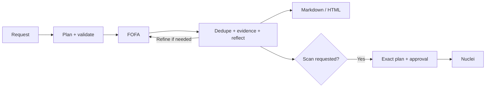

# 🗺️ FofaMap 2.0.2 · From asset discovery to evidence-backed reports

[中文](README.md) · **English**


<p align="center">
  
  
  
  
</p>

**An evidence-driven AI tool for asset discovery and security analysis.**

Developed by **Hx0 Studio**, FofaMap brings **FOFA asset discovery, AI reflection, user-approved Nuclei validation and interactive reporting** into one traceable workflow, connecting each assessment with its queries, reasoning and validation results.

Start with the keyboard-driven wizard, keep using the classic CLI, or connect AI assistants and automation through **MCP / Skill / REST API**. **Ordinary searches need only a FOFA API key, with no model setup required; active scans require user approval.**

<a id="whats-new"></a>

## What makes FofaMap useful?

| Your task | How FofaMap helps | What you get |
|---|---|---|
| Start without learning every FOFA option | Guided account setup, keyboard menus, smart field selection | A clear path from API key to first search |
| Investigate assets in natural language | The Agent plans queries, reflects on actual matches, and separates observed, corroborated and candidate evidence | A briefing with traceable queries and evidence |
| Share useful results | Markdown / HTML reports with filtering, sorting, column selection, visible-row CSV and deduplicated TXT | A report you can open, explore and deliver |
| Work inside your AI assistant | 31 MCP tools plus a companion Skill for multiple hosts | Usually reuse the host model without a second model key |
| Continue into authorized scanning | Your scan intent takes priority; review targets, templates and severity before execution | Discovery, approval, Nuclei results and reports in one task |
| Track inventory changes | Schedules, a separate worker and snapshot comparisons | Repeatable inventory with added/removed asset tracking |

**For your first session, follow steps 1 → 2 → 3 below.** Explore options, models, automation and service deployment later.

| First session | Daily searches | Advanced workflows | Maintenance and reference |
|---|---|---|---|
| [1. Install](#install) | [Query basics](#query-language) | [AI investigation and reports](#agent) | [Update / repair / uninstall](#upgrade) |
| [2. Set your FOFA key](#configure) | [Command recipes](#recipes) | [MCP / Skills](#mcp) | [Troubleshooting](#troubleshooting) |
| [3. First search](#first-query) | [Enable smart fields](#smart-fields) | [Schedules](#schedule) | [Complete options](#cli-reference) |
| [Choose an entry point](#choose) | [Exports and pagination](#exports) | [Authorized scans](#scan) | [Configuration / REST](#configuration) |

<a id="install"></a>

## 1. Install: choose your platform

Download the [FofaMap 2.0.2 user source package](https://github.com/asaotomo/FofaMap/releases/download/v2.0.2/FofaMap-2.0.2-source.zip), **extract the entire ZIP**, and open the folder containing `install.bat`, `install.command` and `install.sh`. See the [2.0.2 release page](https://github.com/asaotomo/FofaMap/releases/tag/v2.0.2) for other download options.

| Platform | What to do | Open it next time |
|---|---|---|
| **Windows 10/11 x64, Windows 11 ARM** | Double-click **`install.bat`**, then select Install | Run `fofamap` in a new terminal, or double-click `start.bat` |
| **macOS Intel / Apple silicon** | Double-click **`install.command`**, then select Install | Run `fofamap`, or double-click `start.command` |
| **Linux x86_64 / ARM64** | Run **`bash install.sh`** in the project folder | Run `fofamap`, or run `bash start.sh` |

**Choose your language first.** The installer starts with **简体中文 / English**. Installation messages, account setup and future sessions use your saved choice; no configuration-file editing is needed. Enter keeps the previous installation language or the system-language default.


The first installation needs network access. The installer prepares isolated Python and dependencies, checks the installation and registers `fofamap`. **No manual environment activation or administrator access is required. Account setup opens at the end; continue with step 2.** Reopen your terminal if the command is not yet available.

<details>
<summary>View the first-install menu</summary>


</details>

<details>
<summary>macOS / Linux: install from a terminal or work around missing execute permission</summary>

### macOS / Linux: one installation command

Alternatively, enter the extracted project directory in a terminal and run the installer and version check below. This also works if a macOS ZIP extraction does not preserve executable permissions for double-click launch.

```bash
bash install.sh
bash start.sh --version
```

<details>
<summary>Actual task output: one-click installation and verification</summary>


</details>

See [manual macOS / Linux installation](docs/INSTALL_MANUAL_EN.md) for custom setups.

</details>

<a id="windows-install"></a>

For Windows issues, see the [Windows walkthrough and troubleshooting](docs/INSTALL_WINDOWS_EN.md). For macOS/Linux, see [manual installation](docs/INSTALL_MANUAL_EN.md). Rerun the installer for repair or uninstall; see [maintenance](#upgrade).

<a id="configure"></a>

## 2. Set your FOFA key

1. Sign in to [FOFA](https://fofa.info/) and copy your **API key** from your account page; register first if needed.
2. Paste it into the account form opened by the installer. Email is optional. Save and verify as prompted.
3. If you only want ordinary searches, choose **skip / N** when offered AI model setup. Add a model later when you need the Agent.

If the form did not open, or you need to change the key, run:

```bash
fofamap --setup
```


**A FOFA key searches assets; a model key calls AI. They serve different purposes.** Keep real keys out of chats, issues and screenshots. Missing, damaged or invalid required configuration opens repair guidance on a later launch.

<a id="first-query"></a>

## 3. Run your first search

### Start with the wizard

```bash
fofamap
```


1. Use the arrow keys to choose **Asset search**, then press Enter.
2. Paste `domain="baidu.com"` to find Baidu’s public websites. This is FOFA syntax entered into the app; no outer shell quotes are needed.
3. Set **Maximum pages to `1`**, then choose **Use configured fixed fields** (or Smart selection). Skip advanced history/export options for now and answer **N** to Nuclei scanning.
4. Wait for the results table. Page size follows your configuration; use the command below if you want an explicit three-record cap.

Use arrows to select, Enter to confirm and Esc / Ctrl+C to go back. The image above shows the current input screen; the next image shows a completed search.

### Or copy a command: three records, no scan

No model is needed. Use one explicit domain, one page, three rows per page, and a three-row cap; disable liveness and automatic saving.

```bash
fofamap -q 'domain="baidu.com"' -f host,ip,port,protocol,title \
  --size 3 --pages 1 --max-records 3 \
  --no-check-alive --no-full --no-save
```


A table of hosts, IPs, ports, protocols, and titles confirms the real query succeeded. The capture distinguishes the upstream matching population from the three-row collection cap; **matched population is not collected inventory**. HTTP/HTTPS and apex/www may be distinct endpoints even when they share an IP.

Read the command left to right: `-q` decides what to find; `-f` chooses returned fields; `--size 3` sets page size; `--pages 1` limits pages; `--max-records 3` caps total rows. `--no-save` prevents file output, not FOFA quota consumption.

Windows beginners can use the wizard above to avoid CMD/PowerShell quoting differences. The command’s quoting is for macOS/Linux; see the [Windows guide](docs/INSTALL_WINDOWS_EN.md) if you need shell-specific syntax.

**You are ready to use FofaMap.** Next, [export a file](#exports), [investigate in natural language](#agent), or [connect your AI assistant](#mcp).

<a id="choose"></a>

## 4. Choose how you want to work

| Goal | Entry point | FOFA key | Extra model |
|---|---|:---:|:---:|
| Search, profile, aggregate, export with known syntax | CLI / wizard | Yes | No |
| Describe a task; let the tool plan and summarize | Local `-ai` Agent | Yes | Configured model required |
| Work inside Codex, Cursor, Claude, etc. | MCP + Skill | Yes | Usually the host’s model |
| Repeat inventory and compare snapshots | schedule + separate worker | Yes | Not for fixed queries with analyze=false |
| Call it from another program | REST API | Yes | Only for Agent endpoints |
| Active scanning | Entry point + Nuclei + exact approval | When collecting targets from FOFA | No for deterministic local scans |

**Three distinct operations:** FOFA is passive index lookup. `--check-alive` actively connects to targets for HTTP liveness. `-n` enters Nuclei scan approval. Beginner searches here explicitly disable liveness and omit `-n`.

### Home and settings menus

The home screen prioritizes the AI task assistant, asset search, host details, and distribution statistics. Batch/favicon searches live under More search methods, rules/fields under Query reference, and account/model/preferences/setup/updates under Settings. Esc returns from a submenu without exiting the application.


Explicit scan/no-scan instructions take priority over AI advice. A user-requested scan prepares candidates and asks for exact plan approval even when AI advises against it. Statistics-plus-scan retains aggregates and fetches bounded targets within the same query scope, reporting partial coverage. Empty targets, query errors, and missing plan approval prevent execution.

### Change the interface language at any time

Open **Settings → Interface language**, choose Chinese or English, and save. It takes effect immediately and is remembered for future sessions without reentering credentials or models.

```bash
fofamap
```


<a id="query-language"></a>

## 5. Learn FOFA queries step by step

**Query fields and return fields are different catalogues.** `domain="baidu.com"` is a condition; `-f host,ip,port` chooses result columns. `product.version` may be a query condition but is not a Stats dimension; syntax fields such as `sdk_hash` are not necessarily return fields.

| Syntax | Meaning | Example |
|---|---|---|
| `=` / `==` / `!=` | Match / exact / exclude | `domain=="baidu.com"` |
| `&&` / `\|\|` / `()` | AND / OR / grouping | `(port=80 \|\| port=443) && country="CN"` |
| `domain` / `host` / `ip` | Domain / host / IP or CIDR | `ip="192.0.2.0/24"` (syntax only) |
| `title` / `header` / `body` | Page evidence | `title="Bing"` |
| `app` / `product` | Official fingerprint / product label | Look up rules; do not guess app names |
| `country` / `region` / `city` | Country / region / city | `country="CN" && city="Shanghai"` |
| `status_code` | Indexed HTTP status | `status_code=200` or `status_code="200"` |
| `after` / `before` | FOFA update time | `after="2026-11-01"`, not first discovery |
| `is_cloud` / `cert.is_valid` | Boolean fields | `is_cloud=true` |

Use straight double quotes around strings. On macOS/Linux, outer single quotes preserve the inner double quotes. On PowerShell, prefer outer single quotes and verify the native argument retains inner quotes; PowerShell versions differ in native argument handling. Paste the FOFA expression into the wizard if needed. Avoid curly quotes. Use English city names; Chinese region names work for China, and country codes are supported.

### Inspect the local syntax catalogue

This makes no FOFA request. Structural validation does not certify membership, app-name existence, or all server semantics.

```bash
fofamap syntax
```

<details>
<summary>Actual task output: Inspect the local syntax catalogue</summary>


</details>

### Inspect return fields and membership capabilities

No FOFA quota is consumed. The capture is the final screen of the actual catalogue. For a complete machine-readable view, use the MCP tool `fofa_fields(section="all")`.

```bash
fofamap fields
```

<details>
<summary>Actual task output: Inspect return fields and membership capabilities</summary>


</details>

<a id="smart-fields"></a>

### Where do I enable smart fields?

**Choose it immediately after the page limit; it is no longer hidden in advanced options.** Go to **Asset search → enter query → maximum pages → Fields for this query → Smart selection**. To save the default, use **Settings → Returned fields → Smart selection**. Ordinary queries need no model key.

```bash
fofamap
```


Ordinary queries initially default to off, configurable in Settings; AI tasks default to on. Add `--smart-fields` to enable or `--no-smart-fields` to disable. Selection follows account capabilities and the task; **ordinary searches do not need an extra model key for this feature**. Check “Smart fields: Yes” in the query overview. For fixed columns, use `-f host,ip,port,title` and disable smart fields; smart selection takes priority when both are enabled.

<a id="recipes"></a>

## 6. Everyday queries: find a recipe

### Look up an official app name first

This ThinkPHP example only looks up local rules; it does not search global assets. Copy the returned query and add your authorized scope explicitly.

```bash
fofamap rules --rule ThinkPHP
```

<details>
<summary>Actual task output: Look up an official app name first</summary>


</details>

### Browse rule categories before choosing a product query

The bundled reference set contains **691 rules across 166 categories**. **510 entries were verified against the signed-in official FOFA library on 2026-11-02**, preserving its exact returned queries. **181 compatibility mappings were not reverified** and are labelled `legacy`. These are local selections, not FOFA’s complete rule population. Categories cover web servers, frameworks, databases, OA/ERP/CRM, mail, operations, cloud/containers, network/security devices, AI, industrial control, cameras, printers, storage, remote management, and industry systems.

Collection stopped when the website reported its 100-search daily limit; unverified entries are not presented as newly verified official names. [Official library](https://fofa.info/library) · [Category and rule details](docs/FOFA_RULES.md) · [Verification data](docs/data/fofa-library-20261102.json).

```bash
fofamap rules --rule-categories
```

<details>
<summary>Actual task output: categories and counts</summary>


</details>

### Filter industrial-control rules

This only reads local fingerprint names and queries; it does not connect to industrial equipment. Filter by an exact official category, or use `-k product` to search names and aliases.

```bash
fofamap rules --rule-category 工业控制
```

<details>
<summary>Actual task output: industrial-control rules</summary>


</details>

### Filter artificial-intelligence rules

The list uses actually verified examples from FOFA’s AI category; unverified product names are not simply turned into `app=` guesses. Add an authorized scope and record caps before an asset search.

```bash
fofamap rules --rule-category 人工智能
```

<details>
<summary>Actual task output: artificial-intelligence rules</summary>


</details>

MCP `fofa_rules` supports `keyword`, `category`, and `limit` (default 50, maximum 200). `category_summary` always lists the full category navigation; `matched_count` and `has_more` identify undisplayed matches. Inspect `verified / verified_at`. Earlier Chinese category terms such as 框架 / 中间件 / OA / 运维面板 remain searchable.

### Combine a domain with an indexed HTTP status

The condition is applied by FOFA; it does not freshly request each website. Bare and quoted numeric status values are supported.

```bash
fofamap -q 'domain="baidu.com" && status_code=200' -f host,port,status_code --size 3 --pages 1 --max-records 3 --no-check-alive --no-full --no-save
```

<details>
<summary>Actual task output: Combine a domain with an indexed HTTP status</summary>


</details>

### Filter collected rows by status and keyword

This requests status_code explicitly, then applies -i 200 and -k 百度 (the Chinese name for Baidu) locally. Filtering happens after retrieval, so fetched rows may still cost quota. Without returned status_code, -i can trigger additional HTTP liveness requests.

```bash
fofamap -q 'domain="baidu.com"' -f host,port,status_code,title -i 200 -k 百度 --size 3 --pages 1 --max-records 3 --no-check-alive --no-full --no-save
```

<details>
<summary>Actual task output: Filter collected rows by status and keyword</summary>


</details>

### Optional: actively check one website now

This actively connects to one collected HTTP(S) endpoint, unlike the passive index recipes. Use only an authorized scope; the capture checks one public Bing web endpoint.

```bash
fofamap -q 'domain="bing.com" && host="www.bing.com"' -f host,port --size 1 --pages 1 --max-records 1 --check-alive --no-save
```

<details>
<summary>Actual task output: Optional: actively check one website now</summary>


</details>

### Profile a single host

Requires Host API access. `--no-host-detail` requests compact output; omit it for per-port details. A domain may map to a shared IP; ports on that IP are not proof they all belong to the domain’s operator.

```bash
fofamap -hq www.bing.com --no-host-detail --no-save
```

<details>
<summary>Actual task output: Profile a single host</summary>


</details>

### Aggregate ports and protocols

Requires Stats API access. Buckets are not a complete inventory. A dimension can return no buckets; that does not prove no such protocol exists.

```bash
fofamap -cq 'domain="baidu.com"' -f port,protocol --size 5 --no-save
```

<details>
<summary>Actual task output: Aggregate ports and protocols</summary>


</details>

Stats dimensions: `protocol, domain, port, title, os, server, country, asn, org, asset_type, fid, icp`. Treat the public contract as the top five per dimension; `--size` cannot guarantee a larger upstream result. `product` is not a supported aggregation dimension.

### Search by a website favicon hash

Fetches the specified site’s favicon/HTML, then searches FOFA by its MurmurHash3 hash. It is not a FOFA-only operation. A shared icon is a fingerprint clue, not proof of shared ownership.

```bash
fofamap -ico https://www.bing.com --size 3 --pages 1 --max-records 3 --no-check-alive --no-full --no-save
```

<details>
<summary>Actual task output: Search by a website favicon hash</summary>


</details>

Use `--icon-file` instead of `-ico` for an existing file, up to 4 MiB. Fetching an arbitrary URL is not offline hashing.

### Search multiple statements from a file

The repository includes [examples/queries.txt](examples/queries.txt), one domain query per line. `--batch-group-size 1` keeps them separate. Each statement is capped at three rows, so the combined cap is six.

```bash
fofamap -bq examples/queries.txt --batch-group-size 1 --size 3 --pages 1 --max-records 3 --no-check-alive --no-full --no-save
```

<details>
<summary>Actual task output: Search multiple statements from a file</summary>


</details>

The default group size is 100, allowing homogeneous IP/domain lines to be combined with OR. Keep deduplication keys, return fields, and per-group budgets explicit. For a beginner file, use query-only lines.

<a id="exports"></a>

## 7. Save and share results

Confirm fields with a small query first. Each command below actually searches the same scope, caps the result at three rows, and writes a file. `-o` specifies the full filename; `--outdir` sets only the default directory. Captures show actual task output and artifact paths.

### Export CSV

Useful for Excel, data platforms, and simple scripts.

```bash
fofamap -q 'domain="baidu.com"' -f host,ip,port,title --size 3 --pages 1 --max-records 3 --no-check-alive --export-format csv --save -o results/readme-demo/inventory.csv
```

<details>
<summary>Actual task output: Export CSV</summary>


</details>

### Export JSONL

One JSON object per line, suitable for streaming; inspect the actual exported structure.

```bash
fofamap -q 'domain="baidu.com"' -f host,ip,port,title --size 3 --pages 1 --max-records 3 --no-check-alive --export-format jsonl --save -o results/readme-demo/inventory.jsonl
```

<details>
<summary>Actual task output: Export JSONL</summary>


</details>

### Export XLSX

Open directly in Excel or another spreadsheet application with headers.

```bash
fofamap -q 'domain="baidu.com"' -f host,ip,port,title --size 3 --pages 1 --max-records 3 --no-check-alive --export-format xlsx --save -o results/readme-demo/inventory.xlsx
```

<details>
<summary>Actual task output: Export XLSX</summary>


</details>

### Send machine-readable JSON to another program

`--json` removes decorative output for parsing. A multi-page CLI run may emit multiple JSON documents; do not assume the entire stream is one JSON array. Prefer `--output-format jsonl` or JSONL export for line-oriented processing.

```bash
fofamap -q 'domain="baidu.com"' -f host,ip,port --size 1 --pages 1 --max-records 1 --no-save --json
```

<details>
<summary>Actual task output: Send machine-readable JSON to another program</summary>


</details>

<a id="pagination"></a>

## 8. Before collecting more: pagination and quota

| Value | Meaning |
|---|---|
| `size` | Rows per page, not the total row count |
| `pages` / `max_pages` | Maximum pages in one operation |
| `max_records` | Overall cap for that operation; accumulation across queries depends on the entry point |
| `total` / population | Upstream matches, not collected rows |
| `records_fetched` | Raw fetched rows; duplicates may still be billable |
| `records_returned` | Rows actually returned to the caller |
| `duplicates_removed` | Duplicates identified and removed in the current chain |
| `reported_consumed_fpoint` | Charges actually reported by the API; null if absent, not an invented zero |

CLI/export allow up to 1,000,000 rows; start much smaller. MCP conversational search is capped at **1,000 rows / 20 pages**; use `fofa_export` for larger inventories. `body` reduces effective page size to 500; `cert/banner/header` to 2,000. A smaller page does not automatically mean the population is exhausted.

### Fetch two real pages: two rows each, four total

The same query displays two actual pages. Check page numbers, returned rows, and population. Collection stops at the cap rather than fetching indefinitely.

```bash
fofamap -q 'domain="baidu.com"' -f host,ip,port --size 2 --pages 2 --max-records 4 --no-check-alive --no-save
```

<details>
<summary>Actual task output: Fetch two real pages: two rows each, four total</summary>


</details>

FOFA cursors are not stable snapshots. Continue immediately with the same query, fields, and size. Expiry `40070` maps to `cursor_expired / restart_search`; restarting is not the next page. Durable storage must handle deduplication across processes, restarts, or unknown cursor chains.

`observe_cost=true` adds account reads before and after an MCP search—two extra requests. Unchanged balances may reflect free pools, delay, caching, or concurrency; they do not prove zero cost. FOFA points and model tokens are separate. `cost_budget` stops subsequent pages after reported spending reaches the threshold; it is not a pre-billing hard monetary cap.

<a id="agent"></a>

## 9. Turn a task description into an investigation

### Configure a model first: DeepSeek is recommended

Open **Settings & maintenance → AI model setup**. DeepSeek is recommended and listed first. Presets also cover Kimi, MiniMax, Xiaomi MiMo, GLM, SiliconFlow, OpenAI, Anthropic, Ollama and LM Studio. Select a provider, enter your endpoint/model/key and verify as prompted. Ordinary queries can still skip this step. See [model defaults and verification date](docs/MODEL_PRESETS_20261102.md).

```bash
fofamap
```

<details>
<summary>Actual task output: refreshed model defaults</summary>


</details>

### Check configured models

Plain queries need no model. `-ai` uses planner, repair, reflector, and summarizer routes. An empty model ID may trigger a model-list API call. Displaying a profile is not proof that a generation request succeeds.

```bash
fofamap models
```

<details>
<summary>Actual task output: Check configured models</summary>


</details>

### Run a bounded real Agent task

The request pins a domain, caps it at two records, forbids expansion/scanning, and sets report language and path. This capture used real FOFA and the configured model, producing Markdown and HTML.

```bash
fofamap -ai 'Query only domain="baidu.com", at most 2 public website records. Do not expand scope or scan. Write an English briefing under 250 words.' --size 2 --pages 1 --max-records 2 --no-check-alive --no-deepseek-search --no-save --report-lang en --report-file results/readme-demo/report-en.md
```


Model prose is advisory and can contain inference errors. Review evidence, gaps, and counts. Corroboration is not legal ownership; no finding is not proof of no vulnerability. Preserve distinct hostnames as separate endpoints even on the same IP.



### Product exposure review: statistics and a one-row sample

Real Redis/Hefei/monthly-update review: aggregate first, then fetch. sample=true explicitly marks a sample; usage is returned. The scan block is simulated with executed=false, not an actual Nuclei scan.

```bash
python scripts/readme_demo.py exposure --language en --output results/readme-demo/exposure-en
```

<details>
<summary>Actual task output: Product exposure review: statistics and a one-row sample</summary>


</details>

### Describe an AI task in the wizard

Select a feature with arrow keys and Enter. Esc/Ctrl+C goes back. An example shares the prompt line; your text starts on the next line. This captured interaction is cancelled before submitting its task.

```bash
fofamap
```

<details>
<summary>Actual task output: Prefer the keyboard-driven wizard</summary>


</details>

<a id="reports"></a>

## How to read the reports and find files

The task above writes `results/readme-demo/report-en.md` and a matching `.html`. Open HTML in a browser from your file manager. Sorting/filtering use data already embedded in the report; no backend service is needed.

Inspect the actual [English Markdown report](docs/assets/readme/2.0.2/examples/report-en.md) or [English HTML report](docs/assets/readme/2.0.2/examples/report-en.html). Download HTML from GitHub and open it locally. These are the real task artifacts, not separately invented examples.

Reports include timing, execution steps, actual queries, collected counts, candidate evidence, AI prose, limits, model routes, and tokens. Tables support search, sorting, Shift multi-sort, restoring source order, field selection, visible-row CSV, and deduplicated TXT. Filtered exports are subsets, not the original full inventory.

MCP `fofa_render_report` / `fofa_agent_run` follow the saved interface language when `report_language` is omitted. Explicit `zh`, `en` or `both` takes precedence. Reconnect an already running MCP server after changing its saved language.

`--report-lang zh/en/both` controls report structure/UI language. `both` creates two versions but does not promise automatic translation of all original asset text or model prose. MCP `fofa_render_report` normally requires `result_count` to equal supplied rows. A larger count needs explicit `sampled=true` and `sample_stop_reason`; do not present a sample as complete inventory.

<a id="mcp"></a>

## 10. Use MCP / Skills in your AI assistant

MCP exposes deterministic tools. The Skill tells a host model how to choose tools, bound scope, handle errors, and report findings. Installing the Skill neither configures your FOFA credentials nor enables scans. If the host performs the analysis, there is no need to call `fofa_agent_run`.

You can give this task to an AI with terminal and local configuration access:

> Use docs/AI_INSTALL.md from https://github.com/asaotomo/FofaMap to install MCP and the Skill for this host only. Verify the downloaded version, preserve existing configuration, use absolute Python/server paths, and never print secrets. Run quota-free checks first, then one baidu.com record after I configure FOFA. Do not automatically scan. Verify actual tool loading, version, and installed Skill hashes before reporting completion.

### List supported hosts

There are nine dedicated installer targets. Other hosts can use their documented generic MCP configuration; a mentioned product name does not imply a built-in installer.

```bash
fofamap integrate --list
```

<details>
<summary>Actual task output: List supported hosts</summary>


</details>

| --agent | Support and limits |
|---|---|
| cursor / codex / claude / opencode | MCP + native Skill; merge configuration and preserve other servers |
| dsh / deepseek-harness | Cordis patch + Skill; primarily Tools, no dependence on Resources |
| lmstudio | MCP + official deeplink; Skill compatibility directory needs a loader |
| openclaw | Codex-compatible plugin bundle; use plugin lifecycle when available |
| hermes | MCP + Skill, untrusted by default |
| grok (gork alias) | Claude-compatible plugin and native Skill |

### Install an integration into an isolated project folder

This writes a Cursor project configuration under `results/readme-demo/host` without changing existing user-level host configuration. Replace project-root with your actual project. For a user-level install, omit the project scope/root options after reviewing the destination.

```bash
fofamap integrate --agent cursor --scope project --project-root results/readme-demo/host
```

<details>
<summary>Actual task output: Install an integration into an isolated project folder</summary>


</details>

The installer pins absolute Python/server paths and cwd where supported. Reinstallation preserves existing env/custom cwd/timeouts and backs up configuration. A PATH failure from an old bare `fofamap-mcp` command is not evidence the service is broken. Restart/refresh that host and inspect the loaded tool list.

### Check whether an installed Skill is stale

Read-only comparison of the release marker and all file hashes. Missing/extra files and changed content—even with the same version—produce a nonzero exit status.

```bash
fofamap integrate --agent cursor --scope project --project-root results/readme-demo/host --check-stale --json
```

<details>
<summary>Actual task output: Check whether an installed Skill is stale</summary>


</details>

### Export, import, and verify a .skill package

These three lines form one task: export the bundled Skill, import it into the same isolated host, and verify it. Export refuses to overwrite an existing archive; use a fresh filename when repeating it.

```bash
fofamap integrate --export-skill results/readme-demo/fofamap.skill
fofamap integrate --agent cursor --scope project --project-root results/readme-demo/host --import-skill results/readme-demo/fofamap.skill
fofamap integrate --agent cursor --scope project --project-root results/readme-demo/host --check-stale --json
```

<details>
<summary>Actual task output: Export, import, and verify a .skill package</summary>


</details>

### Perform a real handshake and release check

No FOFA or model calls. Success includes `ok=true`, version 2.0.2, 31 tools, the negotiated protocol, Python/server paths, and code fingerprint. Expected values must come from the intended release, not from an old executable describing itself.

```bash
fofamap-mcp --check --expect-version 2.0.2 --expect-build-date 2026-11-02 --expect-source .
```

<details>
<summary>Actual task output: Perform a real handshake and release check</summary>


</details>

### Run a real MCP query workflow

Run the included example from the source directory; it starts an isolated stdio server, validates syntax, fetches at most two rows, and reads usage. It shows actual calls/data without printing credentials.

```bash
python scripts/readme_demo.py mcp --language en --output results/readme-demo/mcp-en
```

<details>
<summary>Actual task output: Run a real MCP query workflow</summary>


</details>

<a id="mcp-tools"></a>

## All 31 MCP tools

| Group | Tools |
|---|---|
| Local catalogues / validation | fofa_fields · fofa_syntax · fofa_rules · fofa_validate_query |
| Account and passive intelligence | fofa_account · fofa_search · fofa_search_next · fofa_host_profile · fofa_stats · fofa_icon_search · fofa_exposure_review |
| Reports, Agent, background jobs | fofa_render_report · fofa_agent_run · fofa_export · fofa_job_status · fofa_job_cancel |
| Schedules (7) | fofa_schedule_create · fofa_schedule_update · fofa_schedule_list · fofa_schedule_history · fofa_schedule_set_enabled · fofa_schedule_stop · fofa_schedule_delete |
| Scan preparation/execution (8) | nuclei_capabilities · nuclei_guide · nuclei_templates · nuclei_recommend · nuclei_select_targets · nuclei_customize · nuclei_plan · nuclei_execute |

`fofa_agent_run`, `fofa_export`, and `nuclei_execute` return background jobs. Poll `fofa_job_status` to completed/failed/cancelled; stop work with `fofa_job_cancel`. Keep the same MCP server process alive; a hard restart does not resume jobs. Client timeout does not imply cancellation. REST Agent/scan endpoints differ and do not inherit the MCP async contract.

Resources: `fofamap://fields`, `fofamap://rules`, `fofamap://account`, `fofamap://runtime`, and `fofamap://jobs/{job_id}`. Runtime is quota-free; account reads the actual FOFA account. Tools-only hosts can still complete primary workflows. See the [tool catalogue](agent-kit/skills/fofamap/references/tool-catalog.md) and [reliability guide](agent-kit/skills/fofamap/references/reliability-guide.md).

<a id="transports"></a>

## Choose stdio, Streamable HTTP, or SSE

| Transport | Server launch | Host URL/behavior |
|---|---|---|
| stdio (default) | `fofamap-mcp`, usually started by the host | Absolute Python + mcp_server.py; waiting silently is normal |
| Streamable HTTP | `fofamap-mcp --transport streamable-http --host 127.0.0.1 --port 8001` | `http://127.0.0.1:8001/mcp` |
| HTTP alias | `--transport http` | Same as Streamable HTTP |
| legacy SSE | `fofamap-mcp --transport sse --host 127.0.0.1 --port 8002` | `http://127.0.0.1:8002/sse` |

Keep an HTTP server running in one terminal and connect from another terminal or host. Verify the address with `fofamap-mcp --check-url URL --expect-version 2.0.2`. The captures above and below show actual connection and installation checks. Non-loopback listening requires authentication, issuer, and resource configuration; do not expose an unprotected server publicly.

### Reproduce real HTTP and SSE startup/checks

The example selects free loopback ports, starts both real MCP transports, validates version/tools/source, and cleans up. No FOFA/model quota is used.

```bash
python scripts/readme_demo.py transports --language en --output results/readme-demo/transports-en
```

<details>
<summary>Actual task output: Reproduce real HTTP and SSE startup/checks</summary>


</details>

<a id="schedule"></a>

## 11. Schedule inventory and track changes

**Saving a schedule does not start the worker.** Use item 15 in the wizard for AI-assisted or manual creation. Supported recurrence: once, every N minutes (minimum one), hourly, daily, weekly, monthly, with IANA timezones. Missing dates in a month are skipped; monthly is not a fixed 30-day interval.

### Inspect schedules and worker heartbeat

Read-only; it does not run due tasks. An absent heartbeat means there is no evidence that a worker is polling.

```bash
fofamap schedule --schedule-action list --json
```

<details>
<summary>Actual task output: Inspect schedules and worker heartbeat</summary>


</details>

[examples/schedule.json](examples/schedule.json) defines a fixed domain every ten minutes, capped at ten rows, analyze=false, check_alive=false. `--schedule-spec` creates a full specification. Do not apply that frequency to a large scope without reviewing cost.

### Real due-time execution: create → worker → history → reports

This script uses a separate database and temporary worker so the tutorial cannot claim your existing jobs. It collects at most two records without a model or scanning, then stops/deletes the temporary schedule and retains reports.

```bash
python scripts/readme_demo.py schedule --language en --output results/readme-demo/schedule-en
```

<details>
<summary>Actual task output: Real due-time execution: create → worker → history → reports</summary>


</details>

| Action | CLI mapping | Effect |
|---|---|---|
| Menu | `schedule --schedule-action menu` | Interactive management |
| Create / update | `--schedule-action create/update --schedule-spec examples/schedule.json` | Save config; update also needs --schedule-id |
| History | `--schedule-action history --schedule-id ID` | Read run history and reports |
| Pause / resume | `--schedule-action pause/resume --schedule-id ID` | Reversible pause; resume recomputes a future time |
| Stop | `--schedule-action stop --schedule-id ID` | Stop future runs and request active-run cancellation |
| Delete | `--schedule-action delete --schedule-id ID` | Remove active management; retain history/reports in archive |
| Persistent worker | `fofamap-scheduler --interval 30` | Poll every 30 seconds; keep process running |
| Single poll | `fofamap-scheduler --once` | For cron/systemd timers |

Fixed queries make snapshots more comparable. After changing scope, inspect the comparable flag before interpreting additions/removals. `check_alive=null` follows global settings; explicit task wording takes priority. An unattended worker cannot use interactive-only model credentials; use an API credential or fixed queries with analysis disabled. Review paths, user, and environment file in [deployment/fofamap-scheduler.service](examples/deployment/fofamap-scheduler.service) before installing a service.

<a id="scan"></a>

## 12. Enable Nuclei when you need an authorized scan

### Verify the installed Nuclei binary

Query-only work needs no Nuclei. If scanning requires a missing component, first choose **Y=download official binary/templates, N=manual installation**, default N. Y downloads the matching stable release, verifies SHA-256 and version, installs templates, then continues the approved scope. N/cancel downloads nothing, skips scanning, and retains query/report results. Components use a per-user tool directory without administrator rights; existing PATH / `FOFAMAP_NUCLEI` installations take precedence. For manual installation see [official releases](https://github.com/projectdiscovery/nuclei/releases) and [installation docs](https://docs.projectdiscovery.io/opensource/nuclei/install). MCP/REST `install_if_missing` defaults to false and requires separate user installation consent before true; scanning still requires exact plan approval.

Open Settings → Nuclei component for the same install/update flow, or run:

```bash
fofamap --update-nuclei
```

<details>
<summary>Actual task output: Y/N choice for a missing scan component</summary>


</details>

```bash
nuclei -version
```

<details>
<summary>Actual task output: Verify the installed Nuclei binary</summary>


</details>

### Inspect a real public-scope approval screen without executing

This command fetches at most one FOFA row and opens exact-plan approval. The captured demo is cancelled with Esc; **it does not scan the public domain**. Execute only after obtaining authorization and reviewing the scope.

```bash
fofamap -q 'domain="baidu.com"' --size 1 --pages 1 --max-records 1 --no-check-alive --no-save --no-scan-ai-dedupe -n --nuclei-id tech-detect --severity info
```

<details>
<summary>Actual task output: Inspect a real public-scope approval screen without executing</summary>


</details>

The default `web-baseline` contains ten templates: `http-missing-security-headers`, `cors-misconfig`, `options-method`, `tech-detect`, `waf-detect`, `weak-cipher-suites`, `deprecated-tls`, `expired-ssl`, `self-signed-ssl`, `mismatched-ssl-certificate`. It is not a full-template vulnerability scan. Allowlisting and template-defined protocols/ports are part of the authorized scope.

### Actually execute a controlled local scan

This reproducible example creates a temporary local HTTP service, one info template for that fixture, an isolated database, and one-time approval. Real MCP/Nuclei execution verifies one match. The explicit `--approve-local-fixture` flag is required; the script accepts no arbitrary public target.

```bash
python scripts/readme_demo.py scan --approve-local-fixture --language en --output results/readme-demo/scan-en
```

<details>
<summary>Actual task output: Actually execute a controlled local scan</summary>


</details>

CLI execution always requires approval. MCP/REST additionally require `FOFAMAP_ENABLE_SCANNING=true` and a `FOFAMAP_SCAN_APPROVAL_SECRET` of at least 24 characters. Administrators allowlist custom paths and IDs outside the baseline. Tokens bind exact scope and expiry and are one-use only; never log or reuse them. `-batch` does not bypass approval.

| Situation | Correct handling |
|---|---|
| Web / TCP / TLS / DNS | Preserve real protocols/ports; never convert every target to HTTPS |
| UDP | Use an explicit JavaScript/Code UDP template; udp is not a valid -pt type |
| Headless / Code / File | Explicitly enable each engine in the approved plan |
| AI target selection | Review per-item keep/exclude/duplicate decisions before approval; shared IP/title cannot merge sites |
| Large JSONL lines | Drain pipes in byte chunks; preserve full findings |
| `-ot` | Omits template-encoded; paths and HTTP responses may still be large |
| fake-IP / DNS / TLS errors | Read warnings/statistics; zero matches may be inconclusive |
| Esc / Ctrl+C / deadline | Reclaim child processes, preserve partial output, never claim complete coverage |
| all / all | `--nuclei-id all --severity all` removes filters; avoid as a beginner default |

Workflow: capabilities → guide/templates → recommend → optional select_targets/customize → plan → approval → execute → job_status. Customization accepts mapped Nuclei flags such as `-rl 5 -c 2 -timeout 10`, not `rate_limit=5` or arbitrary shell code. See the [Nuclei guide](agent-kit/skills/fofamap/references/nuclei-guide.md).

<a id="upgrade"></a>

## 13. Update, repair and uninstall

After installation with the one-click installer, run the command below to check and update FofaMap. It checks the [official repository's latest stable GitHub Release](https://github.com/asaotomo/FofaMap/releases/latest), downloading that release's source ZIP or the source archive for its stable tag. It never installs development branches or downgrades. Downloads require GitHub HTTPS addresses; archive paths, project name, and version are validated, along with SHA-256 when provided for a release asset.

```bash
fofamap --update
```

<details>
<summary>Actual task output: checking the latest stable GitHub release</summary>


</details>

The updater backs up and replaces program source, reinstalls dependencies, verifies version/MCP, and repairs the command entry. Configuration, keyring credentials, environment variables, `.env`, `results`, and local state remain intact. Backups, installation logs, and transaction status are under `.fofamap-updates/<timestamp>/`. Failure restores the old source and reinstalls the old package. If environment recovery also fails, status explicitly becomes `source_restored_environment_needs_repair`; rerun the installer to repair dependencies. Windows opens a separate update window and waits for the current launcher to exit, avoiding locked EXE files. Wait for completion before launching again. Stop other FofaMap/MCP processes before updating, then refresh hosts and check Skill freshness afterward. Environments installed separately with pip should use their original package manager; automatic source updates require the source directory and the installer's `.venv`.

This guide documents stable release **2.0.2**. The update check follows GitHub's latest stable release and makes no changes when you are already current. The image above records a real check before publication, when the latest release was still 2.0.1. Update Nuclei/templates with `fofamap --update-nuclei` or `fofamap -up`.


### Install, repair and uninstall

Run the same installer again to manage the application. A fresh installation offers **Install**; an existing installation in this directory or for the current user offers **Repair / Uninstall / Cancel**. Enter its number; Enter defaults to install or repair, and `0` cancels.

| Option | Behavior |
|---|---|
| Install | Create an isolated environment, install dependencies, register `fofamap`, then open required account setup |
| Repair | Keep settings and data, reinstall the application and dependencies, rebuild the command, and verify; recreate a missing/incompatible environment |
| Uninstall | Work offline without Python; remove this installation's `.venv`, marked local Python/download cache, launcher and managed PATH configuration |

**Uninstall preserves source, account settings, keys, databases, query results, reports and backups.** Separately installed Nuclei and host MCP/Skill configuration are preserved too. Rerun the retained installer to install again; remove personal data yourself after backing it up if a complete data removal is wanted. Uninstalling an old directory preserves a command owned by another installation. Unknown tools directories, external environment links and user-modified launchers are retained with a message.

<details>
<summary>Existing installation: repair and uninstall menu</summary>


</details>

For unattended installs, add `--language zh` / `--language en` on macOS/Linux or `-Language zh` / `-Language en` on Windows. CI/redirected input uses the saved/system language unless overridden.

For automation, use `bash install.sh --action install`, `--action repair` or `--action uninstall` on macOS/Linux; `install.bat -Action install`, `-Action repair` or `-Action uninstall` in Windows CMD; or `.\install.ps1 -Action ...` in PowerShell. Without an explicit action, CI/redirected input installs a fresh copy or repairs an existing one; **it never uninstalls automatically**. Repair from a newly extracted directory installs its current source and switches the command to that directory, preserving the previous directory's data. First use or damaged settings still opens account setup after installation/repair. AI model setup remains optional for ordinary queries.

<details>
<summary>How the installer manages Python, commands and logs</summary>

The first installation needs network access. The installer reuses compatible 64-bit Python 3.10–3.13, or prepares project-local Python 3.12 if necessary. Windows 11 ARM uses x64 compatibility mode. An incompatible `.venv` is backed up. The installer registers a **user-level PATH** without administrator rights, preserves FOFA settings and reports, and keeps system Python intact. Open a new terminal after installation and run `fofamap` from any directory.

Installation first verifies **version 2.0.2, the actual source tree, and all 31 MCP tools** without spending FOFA/model quota, then registers and checks the short command. Interactive installation opens account setup immediately for first use or a damaged configuration, verifies the saved key through the FOFA account endpoint, and offers optional model setup. Password input stays outside installation logs. Logs are under `results/install/`. Plain queries need no model; only scanning needs Nuclei.

Windows registers `%LOCALAPPDATA%\FofaMap\bin\fofamap.exe`, copied from the launcher generated by pip inside the virtual environment. It is not a standalone binary shipped in the source ZIP. The installer updates the current user's PATH and notifies Windows. macOS/Linux use `~/.local/bin/fofamap`, configuring `.zshrc`, `.zprofile`, `.bashrc`, `.profile`, existing Bash login profiles, and Fish configuration when Fish is selected. Reinstallation updates the command without duplicating its PATH entry. Existing terminal windows may need to be reopened. Keep the installation directory; rerun the installer after moving it.

</details>

### Confirm FofaMap and Python versions

Check the environment actually running before troubleshooting.

```bash
fofamap --version
python --version
```

<details>
<summary>Actual task output: Confirm FofaMap and Python versions</summary>


</details>

### Read the installed command help

No key is required. The capture shows a real first screen of the longer help output.

```bash
fofamap --help
```

<details>
<summary>Actual task output: Read the installed command help</summary>


</details>

<a id="troubleshooting"></a>

## 14. Troubleshooting

<details>
<summary>fofamap command not found</summary>

Open a new terminal after one-click installation. Inspect `where.exe fofamap` on Windows, `Get-Command fofamap -All` in PowerShell, or `command -v fofamap` on macOS/Linux. Rerun the installer to repair the user PATH and launcher. The local `start.bat` / `start.command` / `bash start.sh` remains available. For manual installation without command registration, activate `.venv` first. Do not mix system Python and the venv.

</details>

<details>
<summary>The old version still runs</summary>

Inspect --version and --check python/server_entry; assert the intended version and source fingerprint, reinstall that environment, and refresh the host.

</details>

<details>
<summary>-700 / auth_failed</summary>

Use a FOFA key, not a model key. Update privately through init. Quota/permission errors are not automatically invalid credentials.

</details>

<details>
<summary>Permission denied</summary>

Inspect account capabilities. Registered users lack Host/Stats; Personal/Education lack Stats. Use plain search or entitled fields.

</details>

<details>
<summary>Invalid query</summary>

Check straight quotes, dangling &&, unknown fields. Look up products with rules and syntax with syntax. An error is not zero results.

</details>

<details>
<summary>40070 / cursor_expired</summary>

Restart the exact search; page 1 is not a continuation. Retain downstream deduplication and continue cursors promptly.

</details>

<details>
<summary>429 / rate_limited / 45012</summary>

Back off, reduce concurrency, coordinate other processes, and respect separate Host/Stats intervals.

</details>

<details>
<summary>Model call fails</summary>

Check base_url, protocol, actual model ID, api_key_env, and execution mode; keep a local model server running.

</details>

<details>
<summary>Total exceeds returned rows</summary>

Total is the population. Inspect size/pages/max-records, deduplication, entitlements, and sampling flags.

</details>

<details>
<summary>Cannot find exports</summary>

Check -o/--outdir, working directory, and the actual final path. --no-save disables exports.

</details>

<details>
<summary>MCP tools missing / unknown tool</summary>

Run the strict check, then verify reconnection and the loaded catalogue. Do not blindly retry side-effecting calls during restart.

</details>

<details>
<summary>Stale Skill content</summary>

Use integrate --check-stale; reimport the current package into the same host, then verify hashes.

</details>

<details>
<summary>Schedule never runs</summary>

Saving does not start a worker. Inspect heartbeat, next_run, timezone, enabled/stopped state, and the worker process.

</details>

<details>
<summary>Scan returns no matches</summary>

Review loaded templates, request statistics, and DNS/TLS/proxy warnings. Fake-IP can invalidate conclusions; zero does not prove safety.

</details>

<details>
<summary>rate_limit=10 customization is rejected</summary>

Use mapped Nuclei flags such as -rl 10 -c 3; targets/output cannot be overridden and shell text is not executed.

</details>

### Real error example: errors are not empty results

This command intentionally ends with a dangling &&. The capture shows the actual failure, which is not a successful zero-row result.

```bash
fofamap -q 'title="x" &&' --no-save --size 1 --pages 1 --max-records 1
```

<details>
<summary>Actual task output: Real error example: errors are not empty results</summary>


</details>

<a id="cli-reference"></a>

## 15. Complete command-line reference

All current Click entry options are listed below by purpose. This is a reference, not an instruction to combine every flag. Complete commands and matching captures appear in the recipes above. Your installed `--help` is authoritative.

### Queries and scope

| Option | Meaning |
|---|---|
| `-ai` / `--ai-query` | Natural-language Agent request; configured model required |
| `-q` / `--query` | Exact FOFA expression |
| `-hq` / `--host-query` | One IP/domain Host aggregation |
| `--host-detail` / `--no-host-detail` | Enable/disable per-port Host details |
| `--rule` | Look up official app name and build query |
| `--rule-categories` | With rules, list all categories and counts without asset queries |
| `--rule-category` | With rules, filter one category, such as 工业控制 / 人工智能 / OA系统 |
| `-cq` / `--count-query` | FOFA aggregation expression |
| `-ico` / `--icon-query` | Fetch favicon from specified website and search its hash |
| `--icon-file` | Search hash of local icon; 4 MiB maximum |
| `-bq` / `--bat-query` | TXT batch input, one query per line |
| `-f` / `--query-fields` | Comma-separated returned fields |
| `--smart-fields` / `--no-smart-fields` | Choose fields by task/account; default on in Agent mode |
| `-p` / `--pages` | Maximum pages, 1–10000 |
| `--size` | Rows per page; aggregation Top N; upstream limits still apply |
| `--max-records` | Total cap, 1–1000000 |
| `--batch-group-size` | Combine homogeneous IP/domain lines, 1–100; default 100 |
| `--full` / `--no-full` | Historical data toggle; otherwise follow config |
| `--dedupe-by` | Explicit comma-separated deduplication fields |
| `-k` / `--key-word` | Local text filter, comma means any match |
| `-i` / `--include` | Keep listed HTTP statuses; may probe if required status is absent |
| `--check-alive` / `--no-check-alive` | Actively check HTTP reachability |

### Presentation and exports

| Option | Meaning |
|---|---|
| `-o` / `--outfile` | Full export filename |
| `--outdir` | Default output directory |
| `--export-format` | xlsx / csv / jsonl |
| `--save` / `--no-save` | Toggle automatic file output |
| `--display-rows` | Terminal preview rows, 1–500; default 100 |
| `--output-format` | table / json / jsonl terminal output |
| `--json` | Alias for --output-format json |
| `--report` / `--no-report` | Toggle automatic Agent Markdown/HTML report |
| `--report-file` | Explicit Agent report path |
| `--report-lang` | zh / en / both report structure/UI language |

### Scanning and compatibility

| Option | Meaning |
|---|---|
| `-V` / `--version` | Print installed FofaMap version and exit |
| `-init` / `--init` | Legacy setup alias |
| `--setup` | Open guided account/model configuration and verify saved settings |
| `-n` / `--nuclei` | Prepare exact scan plan and require approval |
| `--scan-ai-dedupe` / `--no-scan-ai-dedupe` | AI target selection before final approval |
| `--nuclei-id` | Nuclei template ID; repeat; all removes template filter |
| `--nuclei-protocol` | Template protocol; repeat; UDP uses JavaScript/Code |
| `--nuclei-headless` | Enable Headless in approved scope |
| `--nuclei-code` | Enable Code in approved scope |
| `--nuclei-file` | Enable File in approved scope |
| `--nuclei-oast` | Allow out-of-band interactions in approved scope |
| `--severity` | Comma-separated severities; all removes filter |
| `--scan-max-targets` | Approval target cap, 1–10000; default 200 |
| `--deepseek-search` / `--no-deepseek-search` | Per-task deep search toggle; otherwise profile config |
| `-batch` / `--batch` | Legacy unattended marker; never bypasses scan approval |
| `--update` | Check GitHub's latest stable release and update FofaMap |
| `-up` / `--update-nuclei` | Update Nuclei/templates and refresh local help |

### Installation and integrations

| Option | Meaning |
|---|---|
| `--agent` | Installer target or all |
| `--scope` | user or project scope |
| `--export-skill` | Export a new .skill archive; refuses overwrite |
| `--import-skill` | Import .skill for one host only |
| `--check-stale` | Read-only installed Skill version/content check; exits nonzero if stale |
| `--list` | Show dedicated host support |
| `--uninstall` | Remove only FofaMap-managed entries |
| `--dry-run` | Preview integration changes without writing |
| `--server-command` | Override MCP server executable |
| `--project-root` | Explicit integration project root |
| `--force` | Back up an unmanaged conflict before replacement |

### Schedules

| Option | Meaning |
|---|---|
| `--schedule-action` | menu/create/update/list/pause/resume/stop/delete/history/run-due |
| `--schedule-name` | Human-readable schedule name |
| `--schedule-task` | Scheduled task description |
| `--schedule-when` | Natural recurrence/time expression |
| `--schedule-timezone` | IANA timezone, default Asia/Shanghai |
| `--schedule-query` | Fixed FOFA query; repeat for multiple statements |
| `--schedule-id` | Existing schedule ID |
| `--schedule-spec` | Read a complete schedule specification from JSON |

Exit codes: 0 for completion; 1/2 for argument/query/configuration/execution failure; 130 for some cancellation paths. Inspect background job status/error rather than only the first call’s exit code.

<a id="configuration"></a>

## 16. Configuration, credentials and advanced preferences

Prefer `fofamap init` or the wizard’s account/model/preferences menus. Back up YAML before editing; any file containing actual keys should be private and ignored by Git. Copying `.env.example` does not automatically load it; your shell/deployment tooling must explicitly inject variables.

Configuration lookup: explicit FOFAMAP_CONFIG → `config/settings.yaml` in the working directory → per-user config → legacy fallback. User locations: macOS `~/Library/Application Support/FofaMap/settings.yaml`; Linux `$XDG_CONFIG_HOME/fofamap/settings.yaml` (default `~/.config`); Windows `%APPDATA%/FofaMap/settings.yaml`.

This is a **configuration shape, not executable credentials**. See [settings.example.yaml](config/settings.example.yaml).

```yaml
system:
  language: en
  output_dir: results
  scan_ai_dedupe: false
fast_check:
  check_alive: false
providers:
  my_model:
    protocol: openai_chat
    base_url: "https://your-provider.example/v1"
    model: "YOUR_ACTUAL_MODEL_ID"
    api_key_env: MODEL_API_KEY
    credential_kind: api_key
    timeout: 120
routing:
  default: my_model
  planner: my_model
  query_repair: my_model
  reflector: my_model
  summarizer: my_model
  allow_cross_provider_fallback: false
```

| Environment variable | Purpose |
|---|---|
| `FOFA_API_KEY / FOFA_KEY` | Preferred key / legacy alias |
| `FOFA_EMAIL` | FOFA email |
| `FOFAMAP_LANGUAGE` | Session interface language: zh / en |
| `FOFAMAP_CONFIG` | Explicit YAML path |
| `FOFAMAP_STATE_DIR` | Stable service state root |
| `FOFAMAP_DATABASE_URL` | SQLite/PostgreSQL task store |
| `FOFAMAP_PROVIDERS_JSON` | Override provider configuration |
| `MODEL_API_KEY / provider api_key_env` | Model key variable selected in api_key_env |
| `FOFAMAP_BIND_HOST / FOFAMAP_PORT / FOFAMAP_MCP_PORT` | Bind host / REST port / MCP port |
| `FOFAMAP_SERVICE_TOKEN` | Static bearer auth for REST/MCP HTTP |
| `FOFAMAP_JWT_PUBLIC_KEY / FOFAMAP_JWT_ISSUER / FOFAMAP_JWT_AUDIENCE` | JWT verification |
| `FOFAMAP_MCP_ISSUER_URL / FOFAMAP_MCP_RESOURCE_URL` | Non-loopback MCP HTTP protected-resource metadata |
| `FOFAMAP_ENABLE_SCANNING / FOFAMAP_SCAN_APPROVAL_SECRET` | Service scan switch / one-time approval signing secret |
| `FOFAMAP_NUCLEI / FOFAMAP_NUCLEI_TEMPLATE_ALLOWLIST / FOFAMAP_NUCLEI_ID_ALLOWLIST` | Engine path / custom template paths / extra IDs |
| `FOFAMAP_ALLOW_PRIVATE_NETWORK` | Private/loopback access policy override |
| `FOFAMAP_ARTIFACT_RETENTION_DAYS` | Service artifact retention period |

FOFA credential precedence: environment FOFA_API_KEY/legacy FOFA_KEY → system keyring → YAML compatibility storage. New queries reload configuration; environment changes outside a process still require restarting that service. Models normally use the variable named by api_key_env or the keyring; local YAML secrets require explicit wizard confirmation. Service state and CLI output roots can differ; inspect actual `--check` paths.

<details>
<summary>Full initialization, account verification and membership capabilities</summary>

### Run the initial setup wizard

Choose the interface language, then enter your FOFA email and API key. Select “Skip AI for now” if you only need plain queries or an external MCP host. The capture stops at the key field and is then cancelled; it did not overwrite the workstation configuration.

```bash
fofamap init
```

<details>
<summary>Actual task output: Run the initial setup wizard</summary>


</details>

Register at [fofa.info](https://fofa.info/); check the [official API](https://fofa.info/api/introd) and [membership page](https://fofa.info/vip) for capabilities and quota. Enter keys privately in your terminal, not in chat, issues, command-line arguments, or screenshots. The wizard prefers the system keychain and writes YAML only after confirmation. If Linux has no working keyring, follow the wizard’s private-storage option.

**FOFA keys and model keys serve different services.** A chat subscription does not automatically grant model API access. Match the provider’s actual protocol: `openai_responses`, `openai_chat`, `anthropic_messages`, or `ollama_native`. LM Studio uses OpenAI-compatible Chat; local authentication depends on your server settings. Use an actual model ID from that provider rather than a guessed “latest model.”

### Verify FOFA login, membership, and quota

The capture retains actual capability information and hides account identity. Successful authentication does not grant every API.

```bash
fofamap account
```

<details>
<summary>Actual task output: Verify FOFA login, membership, and quota</summary>


</details>

| vip_level | Account tier | Host API | Stats API |
|---|---|:---:|:---:|
| 0 | Registered | No | No |
| 1 / 11 | Personal / Personal plan | Yes | No |
| 2 / 12 | Professional / Professional plan | Yes | Yes |
| 13 | Business | Yes | Yes |
| 5 | Enterprise | Yes | Yes |
| 22 | Education, not Business | Yes | No |

This table describes the program’s built-in mapping; live account responses and current FOFA rules take precedence. `-1` is an upstream sentinel, not unlimited quota. Host calls are spaced by at least one second and Stats by five seconds; separate processes sharing an account still need coordinated overall limits.

</details>

<a id="rest-api"></a>

## 17. REST / OpenAPI for other programs

### Real REST: start → request → return one row

The script starts a real FastAPI server on a random loopback port, reads OpenAPI, and POSTs a real FOFA query capped at one record, then shuts down. It is not TestClient or a mock.

```bash
python scripts/readme_demo.py rest --language en --output results/readme-demo/rest-en
```

<details>
<summary>Actual task output: Real REST: start → request → return one row</summary>


</details>

For persistent use, run `fofamap-api` (equivalent to `fofamap serve`), defaulting to `127.0.0.1:8000`. Swagger UI is `/docs`; the schema is `/openapi.json`. Keep that terminal running and send requests from another terminal, Swagger, or your program. Change the port with FOFAMAP_PORT.

| Method | Path | Purpose |
|---|---|---|
| GET | `/v1/account` | Account/quota |
| GET | `/v1/fields` | Field catalogue |
| GET | `/v1/syntax` | Syntax |
| GET | `/v1/rules?keyword=Redis` | Rule lookup |
| POST | `/v1/search` | Numbered search page |
| POST | `/v1/search/next` | Cursor continuation |
| GET | `/v1/hosts/{host}` | Host aggregation |
| POST | `/v1/stats` | Aggregations |
| POST | `/v1/exports` | Background export |
| GET | `/v1/jobs/{job_id}` | Job state |
| GET | `/v1/artifacts/{job_id}` | Artifact download |
| POST | `/v1/agent/runs` | Agent (runs within request) |
| POST | `/v1/scans/plans` | Exact approval plan |
| POST | `/v1/scans/{plan_id}/execute` | Execute scan (within request) |

A REST search body uses query, fields, size, page; cursor continuation also needs cursor. Export uses search + format + filename. REST errors and synchronous Agent/scan behavior differ from MCP envelopes/background jobs. Non-loopback deployment requires a Bearer token or JWT; MCP HTTP additionally needs issuer/resource metadata. See [security policy](docs/SECURITY.md) and [installation notes](docs/AI_INSTALL.md).

See the [release contents guide](docs/RELEASE_CONTENTS.md) for directory purposes.

<details>
<summary>Examples, screenshots and platform verification</summary>

<a id="evidence"></a>

## About the examples

The macOS command recipes include their actual task output, usually collapsed to keep the guide readable. The commands were run and account identities, email addresses, balances, and credentials were redacted. Chinese and English tasks ran separately; installation examples share one actual isolated installation. Long output shows the first screen, last screen, or the relevant task area. Commands, exit status, and image hashes are recorded in the index below.

- Domain-query recipes use the public Baidu and Bing domains, `baidu.com` and `bing.com`. Live index data changes; screenshot counts are not promises.
- Active execution only targets a temporary local HTTP fixture. The public-domain scan screenshot stops at approval and is cancelled.
- Account names, email addresses, balances, and credentials are redacted. `[hidden]` or asterisks are privacy markers, not usable credentials.
- English examples use English tasks and interface settings where supported. Raw titles, product names, and some existing CLI help may still contain Chinese; output is not fabricated to hide this.
- Windows, macOS and Linux are supported. Terminal images retain the actual output of the platform captured.

See the [command/capture evidence index](docs/assets/readme/2.0.2/CAPTURE_MANIFEST.md).

</details>

<a id="community"></a>

## Hx0 Studio and community

FofaMap is developed and maintained by **Hx0 Studio**. Report problems through [Issues](https://github.com/asaotomo/FofaMap/issues), contribute a pull request, or support the project with a star.


[Studio website](https://hx0studio.com) · [Repository](https://github.com/asaotomo/FofaMap)

### Support development

If FofaMap saves you time, you are welcome to buy us a coffee. Thank you to everyone who tests, reports issues and supports development.


### Acknowledgements

Thanks to **Yuanlong Sec**, the **FOFA co-creator program**, all contributors and our community.


### Follow the studio


Use within lawful authorization. FOFA matches and model summaries do not establish ownership or confirm vulnerabilities; review scan findings. Include the version, platform and a redacted command in bug reports, without keys, approval tokens or private asset lists.

[](https://www.star-history.com/#asaotomo/FofaMap&Date)
